# Pots, ports and the Malabar coast

*A working document on the ceramic evidence for Indian Ocean exchange, c. 300 BC – AD 300, built object by object from the readings.*

Prepared 10 November 2026 for the Friday presentation.

---

## How to read this document

**Sources.** Six readings were supplied: Tomber 2008, Schenk 2006, Schenk 2007, Schenk 2014, Pavan and Schenk 2012, and Shajan, Cherian, Tomber and Selvakumar 2008. These are the primary evidence. Six further publications were taken from the project library to supply object photographs and contexts the supplied readings lack. They are marked **[Supplementary]** wherever they are used, and listed separately in the bibliography. These are: the Pattanam exhibition catalogue (Cherian with Menon 2014, cited as PAMA), Shajan et al. 2004, Cherian 2011, Cherian 2012, Nair 2021–22 and Avanzini 2014. Part 4 draws on eight more, also marked **[Supplementary]**. Four of them were already in the library: Avanzini (ed.) 2011, Pillai 2010, and two chapters from Tomber, Blue and Abraham (eds) 2010. The other four were found online and saved to `readings/supplementary/`: Tomber 2007, Cherian 2015 (the ninth-season report), the PAMA 2020 brief report and Cobb 2023. Two further items were seen only through a web search or an abstract, and are marked **[Web, unverified]** or **[Web, abstract only]**.

**Labels.** Every substantive claim carries one of four labels:

- **[Documented]**: the author reports their own observation of the object or context.
- **[Reported]**: the author repeats someone else's finding, who is named.
- **[Author's interpretation]**: the author's inference.
- **[My interpretation]**: an observation or argument of mine that the publications do not make.

**Pages.** Page numbers are the printed page of the publication, not the PDF page. Where a figure has no printed folio, the page is inferred from the sequence. PAMA is a catalogue of two-page spreads, and its pages are given as its printed folios.

**The single most important caveat.** Not one illustrated Pattanam object in any source held here is published with a trench, locus, layer or accession number. The Pattanam objects below can be analysed as types and as individual pieces, but not as stratified finds. The Tissamaharama material is the opposite: it is the best-contextualised in the corpus, down to grid square, layer and elevation.

**Ed-Dur.** None of the readings illustrates an individual object from Ed-Dur. The site enters this document as a documented comparison in Part 4, not as an object study. Ed-Dur needs its own primary reports, starting with Rutten 2007, before any of its objects can be analysed at the level attempted here.

**Arikamedu.** The same applies. The readings discuss Arikamedu at length, but none illustrates an Arikamedu object with enough information to analyse it. The Arikamedu sigillata sherd with a Tamil-Brahmi graffito (Comfort 1992: 141, fig. 8.13, reported by Tomber 2008: 150) would be the obvious object to add, once Comfort and Begley 1996 are in hand.

**Figures.** All images are crops from the publications, made by `scripts/crop_figures.py`, which records the source page of each. The full image set from all thirteen publications is browsable at `../material/images/gallery.html`.

---

# Part 1. How to read a pot

This part teaches the method by showing it at work on the objects analysed in Part 2. It assumes a reader who can read Greek and Latin and has never held a sherd.

## 1.1 What survives, and which bits matter

Almost nothing survives whole. What the excavator recovers is the **sherd**, a broken fragment, and sherds are not equal. A **rim**, a **base** or a **handle** carries the vessel's shape. A **body sherd**, a featureless piece of wall, usually does not.

Pavan and Schenk put the rule as plainly as anyone: a vessel "can only be classified and dated with certainty on the basis of the rim shapes. Body sherds alone can be misleading and do not provide a basis for firm classifications" (Pavan and Schenk 2012: 199). **[Author's interpretation]**

Tomber makes the same point against coins, which are the evidence a Classicist is more used to: pottery's "identification is more problematic than that of coins since pottery is difficult to classify by description alone, and sometimes even from photographs or drawings, particularly in the case of body sherds" (Tomber 2008: 38). **[Author's interpretation]**

This is why most of the objects in Part 2 are rims and bases.

## 1.2 How to read a profile drawing

Archaeological pottery drawings follow a convention that is easy once known (general convention, not taken from the readings). Look at Figure 1.

- A vertical line marks the axis of the vessel.
- The half on one side shows the outer surface, and the half on the other shows the vessel cut through, so that the **section** (the thickness of the wall) appears as a solid profile.
- A horizontal line at the top marks the rim's diameter, reconstructed from the curvature of the fragment.

Pavan and Schenk's figures add photographs of the sherd inside the outline. Grey shading marks where the drawing restores what is missing.

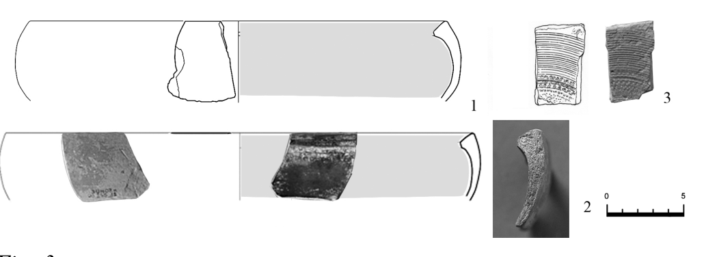

*Figure 1. Sumhuram (Khor Rori, Oman). "1–3. fragments of true RW with typical paste." Pavan and Schenk 2012: 199, fig. 3. Nos 1 and 2 are dish rims drawn as half-profiles with photographs set inside. No. 3 is the decorated base.*

## 1.3 Form: rims, bases and the vessel they imply

**Form** is what the vessel was: dish, cooking pot, storage jar, amphora, cup. It is read from the diagnostic sherds.

Rouletted Ware, the type most debated in this literature, is "simple to distinguish by its typically beaked rim ... and the eponymous decoration impressed on the flat bottom inside the dish" (Pavan and Schenk 2012: 194). **[Documented]**

The beaked rim is the inturned, hooked lip visible in Figure 1, nos 1 and 2.

Amphora identification works the same way, from rim, handle and toe: "it is a simple matter to identify the Dressel 2-4 when a handle or base is present" (Tomber 2008: 43). **[Documented]**

## 1.4 Fabric and inclusions

**Fabric** is the fired clay itself: its colour, texture and the particles in it. The particles are called **inclusions** or, if added deliberately, **temper**. Fabric is what tells you where a pot was made, because clay sources differ geologically.

Tomber's statement of method is the one to memorise:

> "Source identification of pottery can be determined in a number of ways, with the best results through the combination of vessel form and clay fabric. The study of clay fabrics is borrowed from geology and is based particularly on the identification of aplastic inclusions in the clay, either by eye or using a binocular or petrological microscope." (Tomber 2008: 38–39) **[Documented]**

The Campanian amphora fabric is the cleanest example in the readings. Shajan et al. 2008 describe "a 'black sand' fabric consisting of volcanic minerals and rocks" from the Bay of Naples area. Their figure (Figure 2) shows it three ways: the vessel type (A), the fabric in a fresh break (B), and a thin section under the polarising microscope (C), where the volcanic rock fragments and pyroxene crystals are visible.

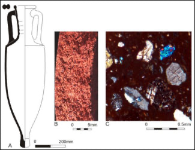

*Figure 2. "A: Campanian wine amphora. B: Campanian fabric in fresh fracture. C: Campanian fabric in thin section showing volcanic rocks and pyroxenes (P. Copeland, R. Tomber)." Shajan, Cherian, Tomber and Selvakumar 2008, fig. 5. The web publication's image is low resolution. The caption does not say whether B and C are from a Pattanam sherd or a reference sample.*

Rouletted Ware is defined by fabric as much as by form. At Tissamaharama it belongs to "a group of different vessel forms that all have in common a very dense and extremely fine grey clay," and this paste "is eye-catching and completely different among contemporaneous southern Indian and Sri Lankan pottery assemblages and should be regarded as determinable for the classification" (Schenk 2006: 129). **[Documented]**

**Fabric can also be a dating criterion.** At Tissamaharama, the early Mesopotamian glazed sherds have a "porous and sandy paste ... commonly pale yellow." The Islamic-period glazed sherds have "a dense and a rather soft, chalky texture tending to a white shade" (Schenk 2007: 59). **[Documented]**

Figure 3 shows the difference. The large sherd *k* has a sandy yellow body under pale blue glaze. Sherds *f* to *i* are deep turquoise over a white body, visible in the small cross-section photographs. On fabric alone Schenk treats *k* as "Sasanian and therefore residual in its context" (Schenk 2007: 60).

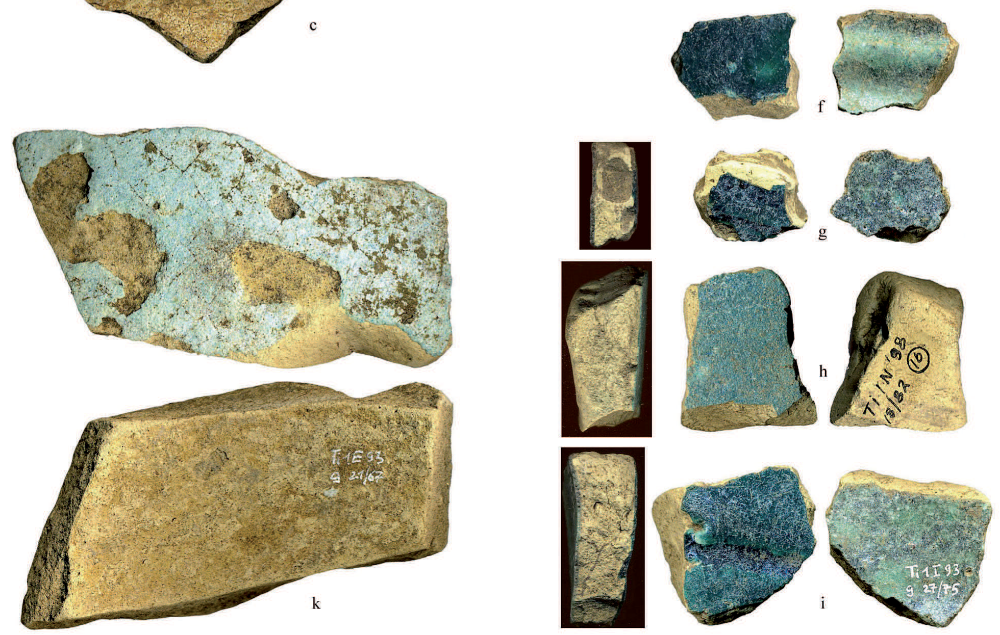

*Figure 3. Tissamaharama. Lower half of Schenk 2007: 79, fig. 6. k: early ("Parthian/Sasanian") fabric with pale glaze. f–i: Islamic glazed ware with chalky white body. The cross-sections are in the narrow photographs at centre left.*

## 1.5 Slip and surface

A **slip** is a thin coat of fine clay applied before firing to colour or seal the surface. Slip is a strong visual signal, and that makes it a trap.

Rouletted Ware was taken for Roman for decades because its "fine quality black and/or red/orange slipped fabric and decoration has contributed to this misattribution" (Tomber 2008: 44). Red Polished Ware was confused with Roman wares "because of the similarity of its surface with Roman red-slipped wares" (Tomber 2008: 46). **[Author's interpretation]**

Surface condition can also date a sherd within a type. Pavan and Schenk separate early from late true Rouletted Ware partly by slip:

- The early group has a "remarkably well preserved" surface with "a brilliant gloss".
- In the late group, "the visible slip ... is easily scratched and therefore usually quite worn".
- In the late group, the slip on the inside is "often flaking" (Pavan and Schenk 2012: 196).

**[Documented]**

## 1.6 Firing

How a pot was fired leaves marks in its colour. **Black-and-Red Ware** (BRW), the characteristic pottery of south India and Sri Lanka in the later first millennium BC, was fired upside down. The PAMA catalogue gives the mechanism in one sentence: "When pots were inverted during firing, oxygen could not reach their interior and hence the blackening of the interior" (PAMA: 91). **[Supplementary] [Documented]**

The striking finding in Schenk's work is that the makers of Rouletted Ware, using the fine grey northern clay, "intended to use the BRW firing technique, one which is typical for the local pottery tradition of peninsular India and Sri Lanka," and often failed. "Most sherds of RW yield a mottled appearance despite the otherwise high quality" (Schenk 2006: 130–131). **[Documented]** It is a technical detail with a large historical consequence, taken up in Part 4.

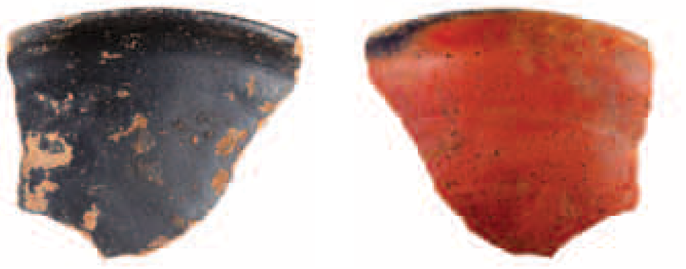

*Figure 4. Pattanam. Black-and-Red Ware rim. PAMA: 91 [Supplementary]. My reading is that the two photographs show the two faces of one sherd, black inside and red outside; the catalogue does not say so. No context is published.*

## 1.7 How the pot was made

Forming techniques leave traces, and those traces can be more regionally specific than the clay.

The decisive Malabar example concerns Indian cooking pots of Wheeler Type 24 found at Berenike and Myos Hormos on the Egyptian Red Sea coast (Figure 18 below). Some "display internal wiping with an organic material considered to be a by-product of bamboo tools." A search of collections at Arikamedu, Nevasa and Nagara in 1998 found no match. "It was not until the site at Pattanam was discovered ... and the pottery from it examined in late 2003 that a match was found." The ethnographic literature described "a technique today known, only to the potters of North Kerala, as scooping" (Tomber 2008: 46–47, citing Saraswati and Behura 1966: 81–3). **[Documented and Reported]**

A second technique is **paddle-and-anvil**. The potter beats the wall with a paddle against an anvil held inside, and a grooved paddle leaves parallel impressions. At Tissamaharama the direction of these impressions changed over time: they run vertically "typical of Tissa Phases a to c1, in contrast to Phase c2, when the pattern runs in a horizontal direction" (Pavan and Schenk 2012: 197). **[Documented]** This is a cheap dating test for any paddle-impressed sherd, and it is applied in Part 2, object 5.

## 1.8 Linings and contents

Pots that carried liquids were often lined. Torpedo jars, the Mesopotamian transport jars, carry "a bitumen lining ... visible on most vessels, [which] indicates that they were used for the transportation of liquid" (Tomber 2008: 39). **[Reported: Stern et al. 2008]**

"The thick black lining helps to distinguish Torpedo sherds, for in India this is much better preserved than on Roman vessels" (Tomber 2008: 42). **[Documented]** Figure 14 below shows the lining on a Pattanam sherd.

## 1.9 Petrography and scientific provenance, and their limits

**Petrography** means cutting a slice of sherd thin enough to transmit light and identifying the minerals under a microscope. It is the most precise way to match a fabric to a geology. Other techniques measure chemistry: X-ray diffraction (XRD), X-ray fluorescence and similar. Three limits run through the readings.

**1. Many minerals are everywhere.** "Many mineral inclusions — such as quartz — are ubiquitous. In these cases typology is essential, for source areas can be suggested through distribution, with the greatest concentration likely to be in the home area" (Tomber 2008: 39). **[Author's interpretation]**

**2. Fabrics overlap.** On amphorae: "Even with visual inspection and petrographic analysis, it can be difficult to attribute some sherds to source area," and Koan fabric overlaps with other eastern fabrics (Tomber 2008: 43, reporting Slane 1992 and Whitbread 1995). **[Reported]**

**3. The answer depends on what you compare against.** Schenk's critique of Rouletted Ware provenance studies is the best lesson here (Schenk 2006: 134–136). Several studies sampled only south Indian and Sri Lankan clays, found that all the Rouletted Ware matched itself, and concluded it was made in the south.

Gogte sampled a northern clay as well, from Chandraketugarh in Bengal, and found the match there. But Schenk notes that "only samples from Chandraketugarh of locally obtained clay represented the northern region." She adds that it is doubtful whether modern clays "more than 2000 years later" can answer questions about ancient pottery. **[Author's interpretation]**

Her conclusion: "Once again we see the need for independent site-by-site studies, a proper definition of wares and the discovery of a kiln site before further efforts on provenance studies are done" (Schenk 2006: 136). No Rouletted Ware kiln has been found.

## 1.10 How a date is built

There are four routes to a date, and the readings use all of them.

**Stratigraphy.** Layers accumulate, so lower is earlier unless something has been dug through. The Tissamaharama report shows the principle literally. In Figure 5, "pots in situ in stratigraphical situation: nos. 136 and 151 (1st century C.E.) on top of nos. 160 and 180 (1st century B.C.E.)" (Schenk 2014: 100, caption to fig. 5).

**Associated finds.** Objects found together in a sealed context date each other. The most explicit case in the readings is the Wheeler type 18 base at Sumhuram, found in a room with three numbered coins (object 4).

**Typology and cross-dating.** A type dated securely at one site dates it at another. This is powerful and dangerous. Wheeler built Arikamedu's chronology from imported wares, and his "typology for local pottery dated in reference to Roman ceramic type-fossils" is "still relied upon throughout South India" (Tomber 2008: 14). **[Author's interpretation]** If the imported type is misdated, every site cross-dated by it inherits the error. That is precisely what happened with Rouletted Ware.

**Radiocarbon.** This dates organic material (charcoal, wood, seeds, shell) and must then be tied to the pottery by context. The Tissamaharama phases are "enhanced by Radiocarbon dates" (Schenk 2014: 101), but none of Schenk's articles prints the dates themselves.

At Pattanam, a radiocarbon date has been used to say more than it can bear. The catalogue says the canoe and bollards at the wharf gave dates within "the 1st century BCE – 1st century CE period" (PAMA: 123). Cherian's own 2012 paper gives the canoe's calibrated range as "1300 to 100 BCE (i.e. 700 ± 600 cal. BCE with 95.4% probability)" and the bollard's as 1100 BCE to 1300 CE (Cherian 2012: 28). **[Supplementary]** The two-sigma range for the canoe ends before the first century BC begins.

**A principle worth adopting.** Schenk dates rare imports *by* the site, not the site by the imports: "imported or rare wares as well as small finds like coins are not considered to be reliable indicators for dating due to their limited number." She quotes Ho: "it might be better to use the sites to date the ceramics" (Schenk 2007: 59). **[Author's interpretation]**

## 1.11 Import or imitation?

Pottery shapes travel without pots. "Pottery shapes are imitated outside their region for a variety of reasons, and detection of this relies on fabric analysis" (Tomber 2008: 39). **[Author's interpretation]**

The clearest case in the readings is the southern copy of the Rouletted Ware dish, analysed as object 3. The imitation has the same beaked rim, but:

- "a cross-sectional examination of the fragments will always reveal the differences both in the colour and the high temper content";
- "the base fragments of coarser quality were never decorated" (Pavan and Schenk 2012: 195).

**[Documented]**

**Pre-firing and post-firing marks.** A mark made before firing was made where the pot was made. A mark scratched after firing shows only who later handled it. Tomber uses a "prefiring painted South Arabian graffito" on a vessel found in Egypt to confirm a Yemeni source (Tomber 2008: 50). **[Documented]** The Tamil-Brahmi inscriptions in object 12 are post-firing and therefore evidence of users, not makers.

## 1.12 Residual or contemporary?

A **residual** sherd is one that was made and broken long before the deposit it ends up in, and was redeposited by later digging. A **curated** object is one kept in use long after it was made. Both put old pots in young layers, and the readings use several tests to spot them.

**Condition.** At Tissamaharama, residual Fine Grey sherds are "worn, solitary pieces" (Schenk 2014: 101).

**Joins.** Sherds of a vessel broken where it lay can be fitted back together. In Trench 3B, Phase c1, "many fragments of 'Rouletted Ware' were mendable, spread all over the layers horizontally." In Phase c2 above, the pieces "were merely singular and worn" (Schenk 2014: 101, 113). **[Documented]**

**Proportion.** In area Tissa 1, "194 fragments of RW are known ... Thirty of them were found in contexts from phase b ... to phase d1. The remaining sherds from the fillings of the later pits are in a worn condition and presumedly were dug up anciently from the earlier periods" (Schenk 2006: 137). **[Documented]** That is 30 of 194 in primary position.

**Reuse.** Hard-fired sherds were picked up and used as rubbing tools, which shows as abrasion on the broken edges (Schenk 2006: 138). Seven of the early glazed fragments at Tissamaharama are catalogued as "used as tool" (Schenk 2007: 72–80).

**A single-period control.** Tomber's method at Berenike: a satellite site, Shenshef, founded only in the fifth or sixth century, cannot contain earlier residual material. So finds there isolate the late signal (Tomber 2008: 76, 165). **[Author's interpretation]**

## 1.13 What pottery can and cannot say about trade

**Containers are not their contents.** An amphora documents that wine or oil travelled. It does not say who owned the cargo, what was given in return, or whether the jar was refilled. Tomber notes written evidence for reuse: an instruction from Berenike to decant local wine into a foreign amphora, and Sedov's suggestion that Dressel 2-4 amphorae were refilled with Arabian wine at Qana and exported to India (Tomber 2008: 154). **[Reported]**

**Fine wares may be possessions, not merchandise.** The Indian fine wares at the Red Sea ports are "represented by small numbers — c. 20 vessels between the two sites" and "may also relate to Indian communities, rather than representing trade in ceramics or their contents" (Tomber 2008: 74). **[Author's interpretation]**

Pavan and Schenk add a further possibility, "prestigious gifts suitable for presentation to persons of high rank" (2012: 200). **[Author's interpretation]**

**Utilitarian pottery is the better trace of people.** "If we wish to use ceramics as an indicator of the physical presence of Indian sailors in a specific place, however, utilitarian pottery could offer a more reliable gauge" (Pavan and Schenk 2012: 200). **[Author's interpretation]** Cooking pots are not traded for profit; they are carried by the people who cook in them.

**Merchants and sailors look the same.** "Foreign residents probably comprised both merchants and sailors, although the two cannot be distinguished archaeologically" (Tomber 2008: 153). **[Author's interpretation]**

**Ease of recognition biases the count.** "The Campanian wine amphora is the single most common type throughout the Indian Ocean. In part this reflects the ease with which the clay fabric can be identified" (Tomber 2008: 156). **[Author's interpretation]** A ware that is easy to spot is over-represented, and a plain local jar is under-represented. Schenk makes the counterpart point: "Regional domestic pottery is considered of higher information value than imported pottery. Such foreign pottery is usually preferred because of easy recognisability, although very scarce in percentage" (Schenk 2014: 101).

---

# Part 2. Twelve objects

The twelve were chosen because each is published with an image good enough to see the diagnostic features, and with at least some information about context or comparison. Together they cover the six categories requested.

| No. | Object | Site | Category |
|---|---|---|---|
| 1 | True Rouletted Ware, two rims and a base | Sumhuram | Indian rouletted ware |
| 2 | Riveted Rouletted Ware rim | Tissamaharama | Indian rouletted ware |
| 3 | Southern imitation of the Rouletted Ware dish | Tissamaharama | Indigenous, imitation |
| 4 | Wheeler type 18 base from room A30 | Sumhuram | Indian fine ware |
| 5 | Storage jar and cooking pots of South Asian origin | Sumhuram | Indigenous utilitarian |
| 6 | Kerala cooking pots with bamboo wiping | Berenike and Myos Hormos | Indigenous utilitarian |
| 7 | Dressel 2-4 rim and handle | Pattanam | Roman amphora |
| 8 | Stamped terra sigillata base | Pattanam | Roman sigillata |
| 9 | "Parthian" glazed jar rims | Tissamaharama | Mesopotamian glazed |
| 10 | Turquoise Glazed ring base | Pattanam | Mesopotamian glazed |
| 11 | Torpedo jar sherd with bitumen lining | Pattanam | Torpedo jar |
| 12 | Local storage jar rim inscribed in Tamil-Brahmi | Pattanam | Indigenous utilitarian |

Two objects that might have been expected were rejected for want of information:

- **The Pattanam sigillata sherd in Shajan et al. 2008.** It is the first sigillata from the whole west coast, but the publication illustrates only a drawing of the Arikamedu type it is compared with, not the sherd. Object 8 replaces it.
- **The Dressel 2-4 fragment at Tissamaharama.** Schenk 2007: 71 and 2014: 98 assert it without a find-spot or phase.

---

## Object 1. True Rouletted Ware at Sumhuram

*Pavan and Schenk 2012: 199, fig. 3. "Sumhuram. 1–3. fragments of true RW with typical paste."*

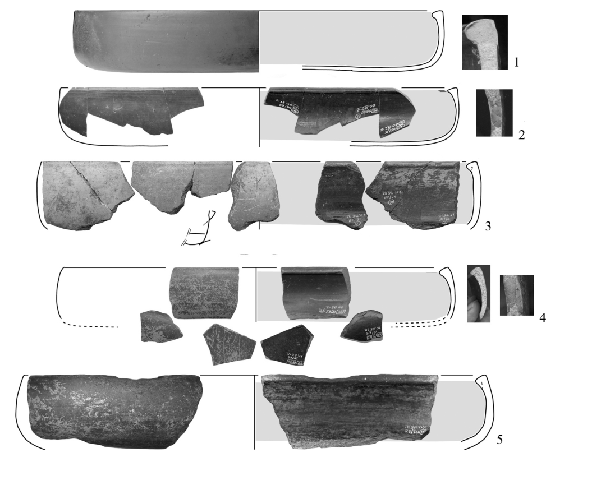

*Comparandum. Pavan and Schenk 2012: 199, fig. 6. "Tissamaharama: overview on the development of RW and imitations. 1–2. early variety of true RW and 3. local imitation; 4. late variety of true RW and 5. local imitation."*

**Identification.** These are three vessels: "two rim fragments and a decorated bottom fragment originating from three different vessels of true RW" (p. 192). **[Documented]** The features that establish the class are:

- the beaked rim, visible in the profile and in the section photograph of no. 2;
- the "typical paste" of the caption, the fine grey clay of section 1.4;
- on no. 3, the rouletted decoration: concentric bands of fine grooves above rows of small notched impressions.

The two rims are assigned to the *late* variety at Tissamaharama (fig. 6/4). The late variety is distinguished by an "inward inclining profile" against the straight wall of the early group, and by worn slip (p. 196).

**Context.** Sumhuram (Khor Rori, Oman), excavated by the Italian Mission to Oman. The article does not give a stratigraphic unit for any of the three pieces. Pavan and Schenk say Rouletted Ware was among sherds "excavated near the surface" and treated as residual (p. 193), and that the base no. 3 "has been found in a later stratum" (p. 197). **[Documented]**

Avanzini 2014: 489 reports "deux bols de type indien" from "les couches les plus anciennes" and illustrates three drawings (fig. 6). It is not stated whether these are the same pieces. **[Supplementary]**

Sumhuram has no independent absolute dates for these layers in Pavan and Schenk: "evaluation of the absolute chronology of the excavated layers of the city has not yet been completed" (p. 192). The pieces are dated by matching them to Tissamaharama:

- the late group there was "discarded not before late Phase c1 (towards the end of the second century BC)" (p. 196);
- the worn base no. 3 resembles five Tissamaharama pieces "dated at the earliest to Phase c2" (p. 197).

**Provenance.** Northern India, by the fabric match to the Fine Grey group. Gogte's XRD analyses point to "a source for the clay ... located in northern India ... on the Ganga Plain" (p. 195). **[Reported: Gogte 2001]** No Sumhuram piece has been analysed.

**Historical significance.** Pavan and Schenk call these finds "thus far unique in the entire Arabian Peninsula" (p. 192). Footnote 6 notes one possible piece at Qana described in the literature as "Indian Red Polished Ware". **[Documented]** On this evidence, products of a north Indian workshop, made for a south Indian market (Part 4, argument 4), reached southern Arabia. The authors conclude that "the region around Muziris, rather than Barygaza, was the nexus point on the subcontinent for Indian Ocean trade at the time of RW" (p. 200). **[Author's interpretation]**

**Limitations.**

1. No sherd has a published layer, and the article itself places Rouletted Ware near the surface and the base in a later stratum.
2. The date is borrowed from Tissamaharama. The authors admit their argument is conditional: "Assuming that this premise holds true for the entire region of southern India and not only for Tissamaharama" (p. 197).
3. No Sumhuram object in the paper is sourced to Malabar. The route claim rests on the distribution of Rouletted Ware along the east coast and the need to round the southern tip (p. 200).

**My interpretation.** The match to the *late* group matters more than the article lets it. It sets the earliest defensible arrival at the end of the second century BC, not the third.

There is a second problem. Avanzini 2014: 498 reports that "les couches les plus anciennes contiennent du matériel chronologiquement incompatible : poterie indienne d'av. J.-C. et amphores du Ier siècle av. ou ap. J.-C." **[Supplementary]** The oldest layers at Sumhuram mix Indian pottery dated BC (by Tissamaharama) with Mediterranean amphorae of the first century BC or AD. Avanzini explains this as disturbance from a rebuilding of the town at the turn of the era.

There is a second explanation that the evidence equally supports. The Indian fine wares arrived *with* the amphorae, in the late first century BC, as old vessels that had been kept. Schenk's own work shows Rouletted Ware being kept and mended (object 2). Tomber notes that the roughly 20 Indian fine-ware vessels at the Red Sea ports sit in late first-century BC and first-century AD contexts, so that "some sherds were curated before being discarded" (Tomber 2008: 74).

The question that follows is testable: are any of the Sumhuram Rouletted Ware sherds mendable and found in joining pieces, the Trench 3B signature of vessels broken in use (object 3 comparandum), or are they all isolated and worn? The answer is in the Sumhuram excavation records, not in the published articles. Part 4, argument 1, develops this.

---

## Object 2. A riveted Rouletted Ware rim at Tissamaharama

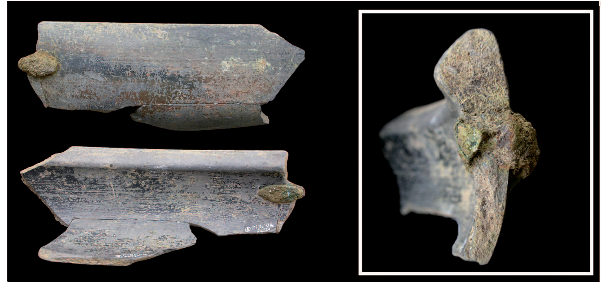

*Schenk 2006: 124, fig. 1c. "rim fragment with bronze rivet on the inside and iron rivet on the outside."*

**Identification.** A Rouletted Ware dish rim, shown in two views with a close-up of the section. The section shows a corroded metal rivet passing through a drilled hole. The caption identifies two metals, bronze inside and iron outside. The mottled grey-black surface with fine horizontal wheel marks matches the "mottled appearance" Schenk attributes to imperfect BRW-style firing of Rouletted Ware (Schenk 2006: 130–131). **[Documented]**

**Context.** Tissamaharama Citadel (Akurugoda), southern Sri Lanka, Sri Lankan–German excavation. "Found in the campaign of 2004" (p. 123) and "found in a structure of the early 1st century A.D." (p. 137). **[Documented]** No context number, phase letter or associated finds are given. No metallurgical analysis of the rivets is reported.

**Provenance.** The Fine Grey group, north Indian on the evidence of Gogte's analyses, as reported by Schenk (2006: 134–136). This sherd itself was not analysed.

**Historical significance.** Schenk uses it to argue that Rouletted Ware was used long after it was made: the riveted vessel "also points to a longer usage of RW dishes postdating their origin" (p. 137). **[Author's interpretation]** She places the end of Rouletted Ware production "in the 1st century B.C. at the latest" (p. 141). Pavan and Schenk add that "quite a few of the RW sherds found at Tissamaharama bear traces of riveting, suggesting that these were highly valued objects worth mending" (2012: 200). **[Author's interpretation]**

**Limitations.** Schenk records the counter-view: Salles, Boussac and Breuil reject repair as a sign of high esteem (Schenk 2006: n. 42). The gap between production and the structure is shorter than "long usage" implies. If production ended in the first century BC and the structure is early first century AD, the vessel may have been decades old, not generations. The rim alone cannot tell us when the vessel was made within the production span.

**My interpretation.** Two different metals in one repair is unusual. It could mean a second repair, or a repair made with whatever metal was to hand. The caption does not say. Either way, it implies there was no replacement to be had. That fits Schenk's own claim that local imitations appeared because supply had stopped (Schenk 2006: 140).

The object also bears on object 1. If a Rouletted Ware dish could be mended and kept into the first century AD in Sri Lanka, a Rouletted Ware sherd in a first-century BC or AD layer at Sumhuram does not need to have arrived two centuries earlier.

---

## Object 3. The southern imitation of the Rouletted Ware dish

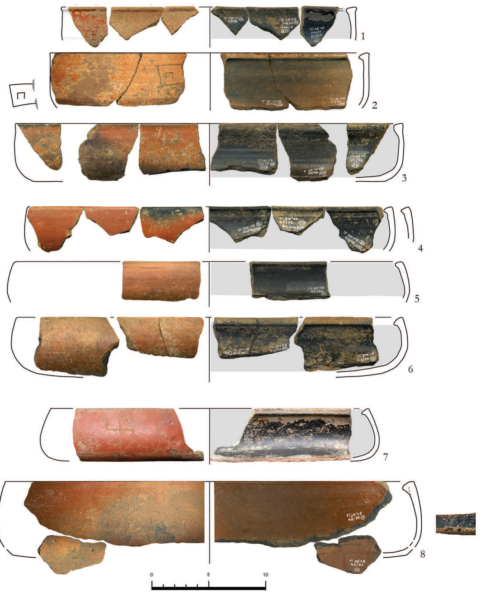

*Schenk 2014: 112, fig. 15. "Tissa Form G1, rim type 9. Southern regional production of flat dish with beaked rim. 1–3 subtype A; 4–6 subtype B; 7–8 subtype C. 1–7 BRW; 8 Fine Red Ware."*

**Identification.** These are dishes with the same beaked rim as Rouletted Ware, made in the local Black-and-Red technique. Exterior views are on the left, generally red. Interior views are on the right, black except no. 8.

Compared with Figure 1 and with the Trench 3B sherds, the surfaces are visibly grittier. The criteria that separate them from true Rouletted Ware are:

- a coarser, more heavily tempered section (Pavan and Schenk 2012: 195);
- no rouletting: "none of the fragments of local 'imitations' of Fine Grey type 11 at Tissamaharama contained the characteristic decoration on the bottom" (Schenk 2014: 114).

**[Documented]**

**Context.** Tissamaharama. Ink labels on the sherds ("Ti 38'08" and similar) show excavation years, but no context is published per sherd. Schenk dates the type: "contexts with Fine Grey type 11 ('Rouletted Ware') also contain locally produced dishes with exactly same beaked rim ... The form is a distinct key type for the 2nd century B.C.E." (Schenk 2014: 114). **[Documented]**

This revises her earlier view. In 2006 she placed the imitation in Phase c2, the first century BC (Schenk 2006: 132), and Pavan and Schenk 2012: 195–196, nn. 15 and 19 record the revision.

**Provenance.** Local or regional southern production. Schenk states that the type "is clearly also produced at many potters' workshops all over the Southern subcontinent" (2014: 114). **[Author's interpretation]** No production site is identified.

**Historical significance.** Schenk proposes the imitation as "an important key type to prove the actual ports of embarkation" (2014: 95). Unlike true Rouletted Ware, which came from the north, the imitation was made where it was used. **[Author's interpretation]**

Pavan and Schenk record that "signs of such repair have also been observed in one fragment of imitation RW found in Sumhuram" (2012: 200). **[Documented]** That piece is not illustrated.

**Limitations.** No per-sherd context. The claim that the imitation's subtypes A to C track the subtypes of true Rouletted Ware is stated but not demonstrated sherd by sherd. If the type was made "all over" the south, finding it at a port does not identify the port without fabric analysis to source each piece.

**My interpretation.** Two details in the plate are not discussed in the text.

- **Incised marks.** No. 2 carries an incised rectangular sign, which the plate redraws at the left. No. 7 carries an incised cross-like sign on the red exterior. Pavan and Schenk say marking vessels "was most popular during the BC periods at Tissamaharama" (2012: 200), and a study of the Tissamaharama graffiti by Falk appears in the same volume as Schenk 2014 (ZAAK 6: 45 ff.). I have not read it. The marks on locally made dishes show that the practice of marking extended to ordinary local tableware, not only to imports.
- **The missing decoration.** The imitation copies the rim exactly, and even its sequence of subtypes, but never the rouletting. The leads at the end of Part 4 return to it.

The practical consequence for Malabar is direct. The PAMA catalogue says Pattanam's Rouletted Ware is "locally produced pottery with the technology of rouletting introduced from the Classical world" and that "Pattanam has the largest assemblage of IRW; more than any other Indian Ocean port site" (PAMA: 92). **[Supplementary]** By Schenk's definition, decorated sherds cannot be local imitations. So either Pattanam has decorated local Rouletted Ware, which would contradict everything at Tissamaharama, or its count combines true Rouletted Ware with undecorated imitations. The sorting can be done on the Pattanam material with the criteria in this object.

---

## Object 4. A Wheeler type 18 base from room A30 at Sumhuram

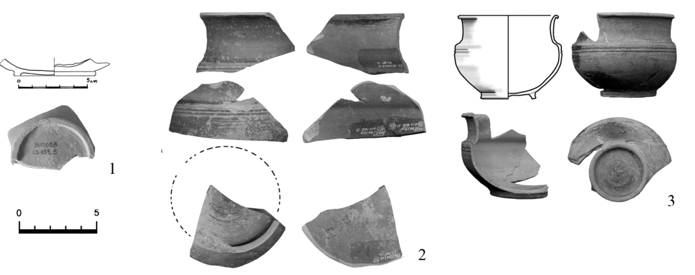

*Pavan and Schenk 2012: 199, fig. 4. "Wheeler type 18. 1. Sumhuram; 2–3. examples from Tissamaharama with different sizes and firing techniques."*

**Identification.** No. 1 is a low ring-foot base, drawn and photographed. Pavan and Schenk identify it as "the base of a carinated bowl, a type denominated as Wheeler type 18 at Arikamedu" and as "a red-fired version that is also known in Tissamaharama" (pp. 192, 197). **[Documented]** In Schenk 2014, Wheeler type 18 is Fine Grey Type 9, first appearing in Phase b, the third century BC (Schenk 2014: 106). An ink label is visible on the sherd. The article does not transcribe it; the reader of these notes made it out as "SU11058 / US-159,5", which is a tentative reading.

**Context.** This is the best-contextualised Sumhuram import in the paper. "Of particular interest are the findings in room A30 in BF1, including a coin from Sumhuram (Co334) and two coins from Yashuril (Co337, Co338), together with the above-mentioned base from a Wheeler type 18 ceramic vessel (Fig. 4/1), which confirm the antiquity of the artefacts" (p. 193). Footnote 7: "Many exemplars of the coinage of Yashuril have been found in Sumhuram in layers datable to the second century BC (Sedov 2008c: 279–281)." **[Documented and Reported]**

**Provenance.** The Fine Grey group, north Indian by implication. The paste is not described.

**Historical significance.** It is the one object where a ceramic date and a coin date can be checked against each other. The authors take the coins to confirm a second-century BC date.

**Limitations.** Three, and they compound.

1. **The article contradicts itself on context.** On p. 198 the same base is listed among "other pieces found in later contexts, such as the Wheeler type 18 base (Fig. 4/1)". The article does not reconcile this with room A30. **[Documented inconsistency]**
2. **The coin date is reported, not argued.** The second-century BC date comes from Sedov 2008c, not from these coins.
3. **The king's date is disputed in a supplementary source.** Avanzini 2014: 498 names "le roi Yashhuril ... roi de la deuxième moitié du Ier siècle av. J.-C." in connection with the rebuilding of the town. **[Supplementary]** Neither text says whether the same ruler or the same coin series is meant. Hadrami coinage can carry the same royal name across reigns, so this needs checking in Sedov 2008c before anything is built on it.

**My interpretation.** The coins in room A30 can confirm a second-century BC date only if Yashuril's coinage is second century BC. Avanzini, who directs the Italian Mission at Sumhuram, puts a king of that name in the second half of the first century BC. If that is the ruler of the A30 coins, the room's coins point to the same late first-century BC horizon as the amphorae in object 1, not to an earlier one. The base may still be old, since Wheeler 18 begins in Phase b at Tissamaharama. But the association would then show it in use in the late first century BC, which is the curation pattern again.

This is the single most useful check for the thesis, because it is decidable from published numismatics.

---

## Object 5. South Asian household pottery at Sumhuram

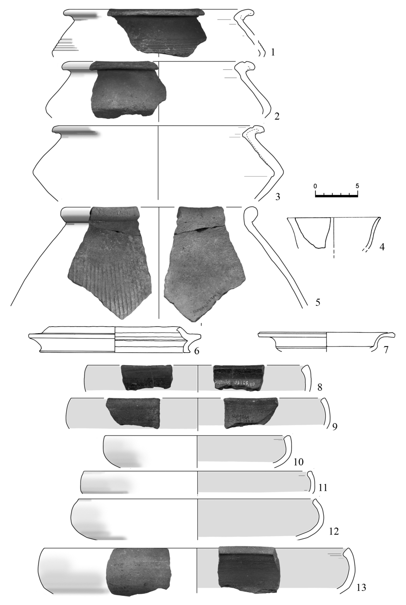

*Pavan and Schenk 2012: 193, fig. 1. "Sumhuram. Pottery of South Asian origin from earliest occupational layers. 1–7. Red Ware; 8–9. Black Ware; 10–13. BRW."*

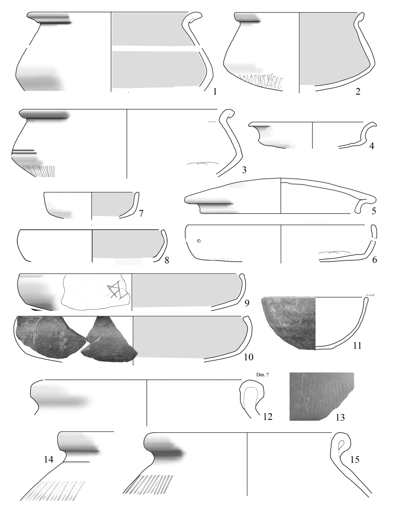

*Comparandum. Pavan and Schenk 2012: 199, fig. 5. "Selected pottery from contexts of phase c1 (second century BC) in Tissamaharama."*

The object for close analysis is **no. 5, a storage jar rim**, with the cooking pots nos 1 and 2 as its companions.

**Identification.** No. 5 is a storage jar rim with a rolled lip. The exterior photograph shows fine, closely spaced, vertical parallel grooves on the shoulder. These are the marks of a grooved paddle (section 1.7). Nos 1 and 2 are cooking pots with thickened, out-turned rims and a carinated shoulder (an angular change in the wall). The authors match them to Tissa Form A (p. 198).

**Context.** Sumhuram. The figure caption says "from earliest occupational layers", and the text limits the analysis to "a single, stratigraphically definable context (KR I) corresponding to the earliest occupation levels of the city in the BC layers" (p. 192). But no. 5 is explicitly "from a mixed layer" (p. 197). **[Documented]** KR I is not further defined.

**Dating.** The rim form of no. 5 "belong[s] principally to Phase c1 (Fig. 5/12, 14–15). The paddle impressions on this jar resemble those of other vessels from the same phase (Fig. 5/13–15)" (p. 197). The cooking pots share "the rather plump shape of the vessels compiled there from the contexts of Phase c1/early Phase c2" (p. 198). **[Documented comparison]**

**Provenance.** Southern South Asia, but not Tissamaharama. Of the cooking pots: "Their rather coarse clay texture, however, has nothing in common with the paste and technical quality of the Fine Red Ware from Tissamaharama, apart from its reddish colour." Their source "remains to be established, somewhere in the southern part of India or Sri Lanka" (p. 198). **[Documented and Author's interpretation]**

**Historical significance.** These are not luxuries. Pavan and Schenk argue that utilitarian pottery is the better indicator of "the physical presence of Indian sailors" (p. 200). They conclude that "the number of vessel types originating from the South Asian subcontinent was higher than was previously thought and included many more utilitarian vessels (pots, casseroles, lamps and lids)" (p. 192). **[Author's interpretation]**

**Limitations.**

- The storage jar is from a mixed layer.
- Matching is by form alone, and the authors say the clay does not match.
- No counts are given for any type.
- The vertical-paddle rule comes from one site, Tissamaharama, and has not been tested elsewhere.

**My interpretation.** The combination of matching forms and non-matching clay is itself the finding. The pots were made somewhere in the south, by potters working in the same canon of shapes as Tissamaharama's but on different clay. That is evidence for a shared southern potting tradition, which is what one would expect if the people using these pots at Sumhuram came from a broad region, not one port.

For Malabar, the paddle test is immediately usable. Shajan et al. 2004: 317 list "paddle-impressed pottery" among the Pattanam surface finds that compare with Red Sea material. **[Supplementary]** If those sherds have vertical impressions, by the Tissamaharama rule they belong to the second century BC or earlier. If horizontal, the first century BC or later. Either result dates Pattanam's earliest Indian Ocean contact independently of imported fine wares.

---

## Object 6. Kerala cooking pots on the Red Sea

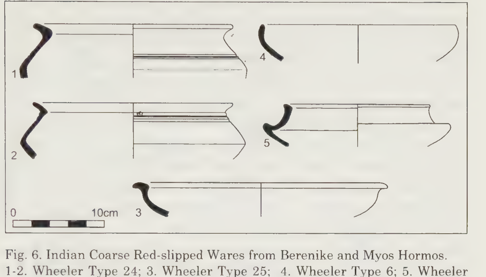

*Tomber 2008: 47, fig. 6. "Indian Coarse Red-slipped Wares from Berenike and Myos Hormos. 1-2. Wheeler Type 24; 3. Wheeler Type 25; 4. Wheeler Type 6; 5. Wheeler Type 29."*

**Identification.** Profile drawings of Indian cooking-pot and bowl rims. Nos 1 and 2 are Wheeler Type 24, the type at issue: a jar with a short, sharply everted rim. The ware is Coarse Red-slipped Ware (CRSW), "coarse red wares, frequently with red slip that may be burnished" (Tomber 2008: 46). The Red Sea vessels "are frequently sooted on the outside, establishing their use as cooking vessels" (p. 46). **[Documented]**

The diagnostic feature is not visible in a drawing: the internal wiping marks left by bamboo tools (pp. 46–47). The caption does not say which of the drawn sherds show the wiping, or which come from Berenike and which from Myos Hormos.

**Context.** Berenike and Myos Hormos (Quseir al-Qadim), Egypt. No context or date is given per sherd in Tomber 2008. Tomber states that CRSW "were most common during the Early Roman period and may be residual thereafter" (p. 75). **[Documented]** The primary publications are Tomber and Begley 2000 and the Berenike and Myos Hormos reports.

**Provenance.** North Kerala, on three grounds:

- the bamboo wiping had no parallel in collections from Arikamedu, Nevasa and Nagara (searched 1998);
- it was matched to Pattanam pottery examined in late 2003;
- the ethnographic literature describes the technique as known today "only to the potters of North Kerala" (pp. 46–47).

**[Documented and Reported]**

Tomber's own verdict: "In this way a direct link between Kerala and the Red Sea was established" (p. 47). She confirms having seen the feature herself at Pattanam: "among the CRSW were sherds with the distinctive internal wiping marks seen at Berenike and Myos Hormos, but not elsewhere in India outside Kerala" (p. 142). **[Documented]**

**Historical significance.** This is the only pottery found abroad that the readings tie specifically to the Malabar coast. The link rests on how the vessels were made, not on what was traded in them. And they are cooking pots: Indian coarse wares in Egypt are "restricted to port sites and therefore appear[] to have been primarily for use there, or on board ships" (pp. 172–173). **[Author's interpretation]**

**Limitations.**

- The match is by forming technique and by eye, not by petrography. Tomber herself says petrography of Type 24 shows "numerous production centres were involved" (pp. 47–48).
- The ethnographic analogy is from 1966, nineteen centuries after the pots.
- "Some seen in Kerala" is not a count.
- No sherd in the figure is identified as one that carries the marks.

**My interpretation.** Malabar's clearest signature abroad is not a traded commodity but a kitchen. Set it beside two other Red Sea objects in Tomber.

- **A graffito.** At Myos Hormos, an Indian storage jar carries a Tamil-Brahmi graffito "incised upside down on the rim", read *paanai oRi*, "pot (suspended in) a rope net" (Tomber 2008: 74–75, fig. 13, citing Mahadevan 2007). It is shown in Figure 13 below.
- **A food store.** At Berenike, an Indian storage jar "contained 7.5 kg of South Indian black pepper ... found in situ in a first-century AD courtyard immediately north of the Serapis temple, the pepper seemingly intended for ritual purposes" (Tomber 2008: 75, fig. 14).

Together the three describe south Indians cooking, labelling and storing their own provisions at the Egyptian ports. That is a stronger claim for indigenous agency than any count of Roman objects in India. Part 4, argument 2, develops it.

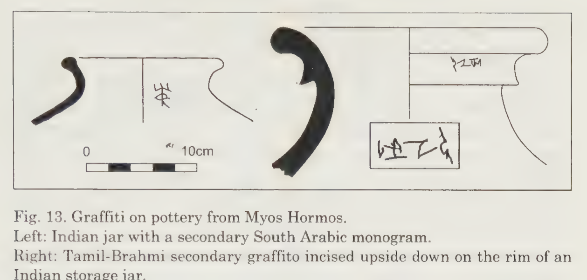

*Figure 13. Tomber 2008: 75, fig. 13. "Graffiti on pottery from Myos Hormos. Left: Indian jar with a secondary South Arabic monogram. Right: Tamil-Brahmi secondary graffito incised upside down on the rim of an Indian storage jar."*

---

## Object 7. A Dressel 2-4 amphora rim and handle from Pattanam

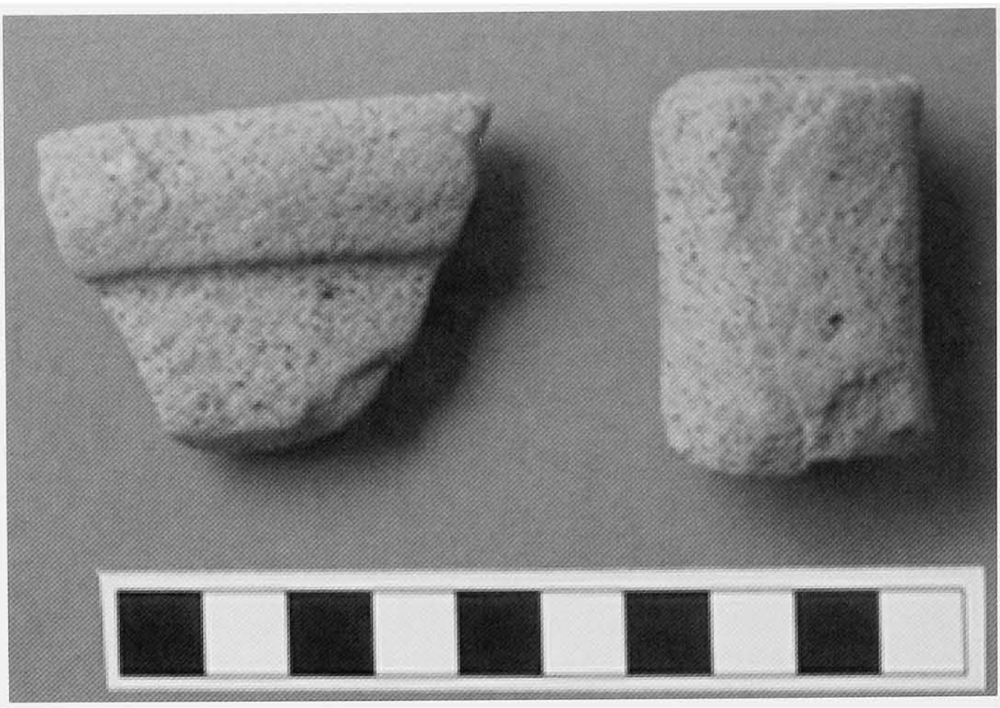

*Shajan, Tomber, Selvakumar and Cherian 2004: 318, fig. 5. "Rim and handle of Dressel 2-4 Campanian amphora from Pattanam." **[Supplementary]***

**Identification.** On the left is a rounded collar rim with the start of the neck. On the right is a section of handle. The Dressel 2-4 is the Roman wine amphora with a tall neck and long, angular handles. When complete, the handles are typically "bifid", formed of two joined rods.

The authors' identification: "two sherds (a rim and handle; fig. 5 here) belonging to the classic Italian wine-amphora Dressel 2-4 (Peacock and Williams Class 10) from the region of the Bay of Naples" (p. 318). **[Documented]** Tomber, a co-author, is the specialist. The fabric is not described in the article. Whether rim and handle belong to one vessel is not stated.

**Context.** A survey find, not excavated. Shajan collected material from the surface and from "a fresh, exposed pit-section (2 x 1 m, depth of 1.5 m)" (p. 317). Which of these produced the two sherds is not stated.

**Date.** "Common between the late 1st c. B.C. and c. A.D. 79" (p. 318, citing Williams 1994). This is the date range of the type, not of the deposit.

**Provenance.** Campania, the Bay of Naples. The attribution rests on the specialist's identification. As Tomber explains elsewhere, Dressel 2-4 "was produced in most Roman provinces," and "fabric is necessary to distinguish the specific source area" (Tomber 2008: 43). The supplied reading Shajan et al. 2008 adds that the Campanian amphora is the most common at Pattanam, recognised by its "'black sand' fabric" (Figure 2 above). Tomber examined the Pattanam amphorae in person (Tomber 2008: 176, endnote 2).

**Historical significance.**

- The excavated scale of what this sherd represents is large: 6,029 amphora sherds in the 2007–2011 seasons (Cherian 2012: 25, table 2). **[Supplementary]**
- Tomber, quoted in Cherian 2011: 4, reports "a peak of Roman contact during the later first century BCE and first century CE".
- The wine connects to the written record. Tomber notes that "the dominance of Campanian amphorae in first-century deposits at Myos Hormos and Berenike correlates with evidence from the Berenike ostraca for the shipment of Italian wine to India" (Tomber 2008: 157). **[Reported]**

**Limitations.**

- A survey find has no stratigraphy.
- The date is the type's range.
- Campanian fabric is easy to recognise and therefore over-represented relative to other sources (Tomber 2008: 156).
- An amphora shows that wine arrived, not who drank it. PAMA's view that amphorae "are likely to have been for resident merchants and traders from the West, as well as for local elites" (PAMA: 47) is an interpretation. **[Supplementary]**
- Reuse and refilling cannot be excluded (Tomber 2008: 154).

**My interpretation.** The terminal date matters. Campanian production of this type ended with the eruption of Vesuvius in AD 79 (Tomber 2008: 156 refers to "the magnitude of the Campanian wine industry before the eruption"). So a Campanian Dressel 2-4 at Pattanam is one of the few objects in the corpus that is closely dated to the Periplus horizon, around AD 50, by its own manufacture, not by its context. It is the archaeological counterpart of the Periplus's list of imports at Muziris, which includes wine. Part 4, argument 3, makes it the one Pattanam object dated to the Periplus horizon by its own manufacture.

---

## Object 8. A stamped terra sigillata base from Pattanam

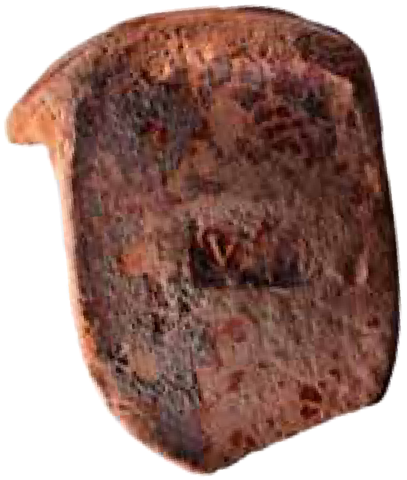 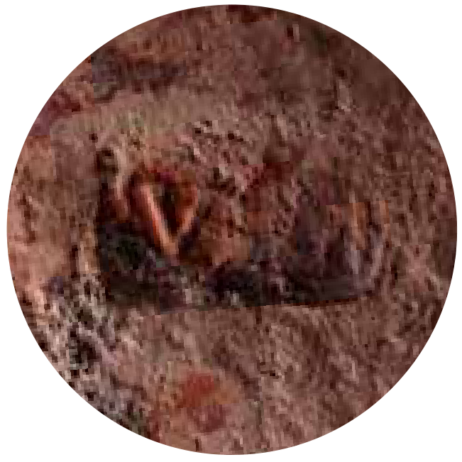

*PAMA: 32 (left) and 45 (right, close-up of the stamp). **[Supplementary]** Captions: "Stamped potsherd / Pottery produced in the Roman region was often stamped with the name of the workshop. One such stamped sherd is exhibited here" (p. 32). The close-up is in the "Terra Sigillata" section (pp. 44–45).*

**Identification.** A red, glossy-surfaced base fragment with part of a foot visible. In the centre of the floor is a rectangular stamp, of which the first letter reads clearly as V. **Terra sigillata** is the red-gloss tableware of the Roman world, often stamped with the workshop's name. Italian sigillata, formerly called Arretine, is the earliest major series.

The catalogue: "Most of the sherds from Pattanam are from Italy, of a type earlier known as Arretine ware ... Pattanam has produced two stamped Terra Sigillata sherds" (PAMA: 44). **[Supplementary] [Documented]**

**Context.** Not published. The fifth-season report records: "One base had a stamp of three letters 'VIL' probably part of a potter's mark" (Cherian 2011: 4). **[Supplementary]** That this is the same sherd is my inference from the visible V; no source says so.

**Date.** None is given for this sherd. Tomber, quoted in Cherian 2011: 5, places the Pattanam sigillata "mostly [in] the late first century BCE and the early first century CE". The Arikamedu sigillata, the main comparison, is now dated "between c. 10 BC and AD 50" (Tomber 2008: 136, reporting Comfort 1992 and Slane 1996).

**Provenance.** Italy, by the catalogue's general attribution. A stamp, once fully read, can name the workshop and its date range in the standard corpus of Italian sigillata stamps. That reading has not been published.

**Historical significance.** The supplied reading Shajan et al. 2008 reports the first sigillata from Pattanam as "the first occurrence of Roman sigillata not only from the Malabar but from the entire west coast of India." It was a small, abraded base, probably of a large platter, likely of the late first century BC or early first century AD. Shajan et al. add that "the Roman pottery found at Pattanam is thought to have arrived via the Egyptian Red Sea ports, where Italian sigillata is common at both Myos Hormos (Quseir al-Qadim) and Berenike." **[Documented and Author's interpretation]**

The excavated total by 2011 was 122 sherds (179 by 2015: Cherian 2015: 750), "the largest quantity of terra sigillata ever recovered from an Indian port site", against 88 at Arikamedu and 3 at Alagankulam (Cherian 2011: 4). **[Supplementary]**

**Limitations.** The stamp is unread beyond its first letter. There is no context. The link to the 'VIL' base is inferred. The two sigillata publications at Pattanam (2008 and the 2014 catalogue) do not illustrate the same sherd.

**My interpretation.** An earlier draft of this document read the season counts as a cluster. Cherian's table gives sigillata by season as 2, 7, 0, 2 and 111, the last being 2011 (Cherian 2012: 25), and the 2011 trenches were described as "in the northwestern sector 500 m away from the area where a wharf structure and a ca. 2000-year-old canoe were excavated earlier" (Cherian 2011: 1). **[Supplementary]**

Two things undo that reading.

- **The later seasons kept producing sigillata.** By 2015 the total was 179 (Cherian 2015: 750), so 2011 holds 62 per cent of it, not 91.
- **The 2011 trenches were in two places.** Cherian 2015's trench table puts four of them on the Padamadathil plot, about 125 m from the wharf plot, and six at Madathilparambu, about 500 m away (Cherian 2015: 742; `../material/data/excavations/pattanam_trenches.csv`).

A season total cannot say which group the sherds came from.

What the object can still carry is its function. Sigillata is tableware, and at Pattanam it runs at about 2 sherds for every 100 amphora sherds. Part 4, argument 2, asks whether tableware like this needs foreign residents to explain it. The trench-by-trench counts in the KCHR records are what would show whether it concentrates anywhere.

---

## Object 9. "Parthian" glazed jar rims at Tissamaharama

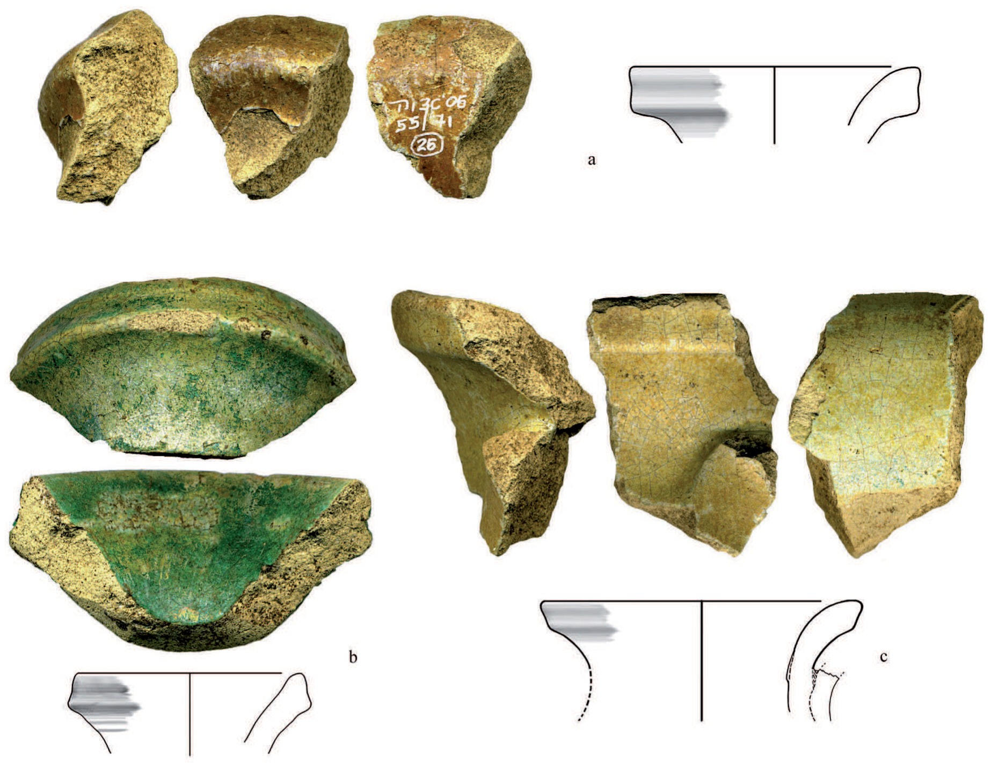

*Schenk 2007: 73, fig. 2 (upper part). "Tissamaharama – a, c Parthian glazed pottery; b, d, e Parthian/Sasanian glazed pottery – diagnostic forms – a, c phase d2; b, d, e phase e."*

**Identification.** Three rims of a jar or amphora with a flaring rim and a softly grooved lip.

- **2a** (top row) is a small thick rim with "trace of handle underneath lip", rim diameter 9.0 cm.
- **2b** (centre left) has the best-preserved green glaze in the article.
- **2c** (centre right) has a handle attachment below the rim, rim diameter 10.0 cm.

The glaze on 2a and 2c is "golden-yellowish deteriorated, cracked." The body is "pale yellow (Munsell 2.5Y 8/3), porous and sandy" (Schenk 2007: 72). **[Documented]**

These are glazed earthenwares in the alkaline-glaze tradition of Mesopotamia, the class whose turquoise variety Pattanam publishes as "Turquoise Glazed Pottery".

**Context.** Exceptionally full for this corpus:

- 2a is from Tissa 3, area C, grid 55/71, layer 26, phase d2 (2nd century AD). The ink label reads "Ti 3C'06 55/71 (26)", so it was excavated in 2006.
- 2c is from 3G, grid 65/72, layer 19, phase d2.

Both come from "features used in phase d2 (2nd century A.D.) apparently backfilled for construction levelling at the beginning of phase e (3rd century A.D.). However, the pottery within the refilled soil still belongs to the phase d2" (Schenk 2007: 60). **[Documented]**

**Date.** Two different dates are in play. Typologically, the rims find "the best analogies ... among the published material for Qal'at al-Bahrain, period VIIIa and Uruk-Warka with a dating at least to the 2nd and 1st century B.C." (p. 61). Schenk concludes that "the dating range of the vessels imported to Tissamaharama points to the 1st century B.C. up to the first half of the 1st century A.D. Nevertheless, within the 2nd century A.D. they were finally discarded into Sri Lankan soil" (p. 62). **[Author's interpretation]**

**Provenance.** Mesopotamia or the Gulf, on three grounds, none of them analysis of these sherds:

- visual match to published Gulf material;
- "Alexander V. Sedov who has supported this identification" (p. 60, n. 6);
- one analysis of glazed pottery from Ed-Dur (p. 61, reporting de Paepe et al. 2003).

**Historical significance.** Schenk argues that Mesopotamian glazed wares reached Sri Lanka in the Parthian period, earlier than the Sasanian date previously assumed. She also argues that they came by way of South Arabia, not directly from the Gulf: "the South Arabian ports served as reloading points for goods such as the Mesopotamian glazed vessels, most probably with some content" (p. 70). **[Author's interpretation]**

**Limitations.** The "Parthian" date rests on four catalogue entries from one kind of deposit, a backfill. Everything else is phase e or later.

The labels follow the layer, not the sherd. Fourteen sherds "belong to phase e ... and therefore identified as of Sasanian origin" (p. 60). Rim 2b is the same form as 2a and 2c but labelled "Parthian/Sasanian" because it was found in phase e. **[Documented]**

The counts in the text do not reconcile: 38 fragments in total, "thirty-four" from Tissa 3, and "27" in another tally (pp. 59–60).

**My interpretation.** Two lessons, one about this object and one about Pattanam.

1. **Firm date versus typological date.** The firmest statement the evidence supports is that vessels of this sandy fabric were broken and thrown away at Tissamaharama by the end of the second century AD. Their first-century BC date is a typological inference from three rims.
2. **Fabric first, then date.** Schenk's own fabric contrast (section 1.4, Figure 3) is the tool for sorting any glazed assemblage before dating it. Pattanam's glazed sherds have been called Sasanian (Schenk 2007: 58, reporting Shajan, Selvakumar and Tomber 2005). If sorted by fabric, the sandy pale-yellow group would be candidates for the Periplus horizon, and the chalky white group would not. That is object 10.

---

## Object 10. A Turquoise Glazed ring base from Pattanam

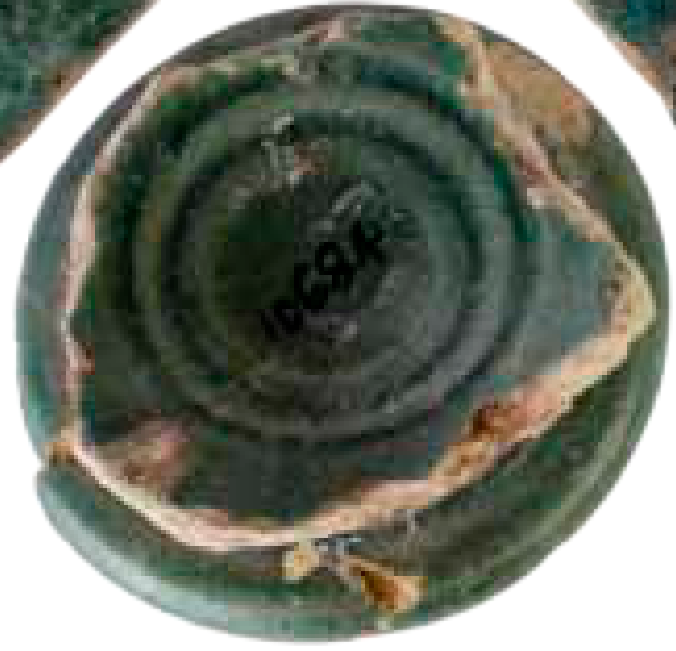

*PAMA: 57. **[Supplementary]** From the "Turquoise Glazed Pottery (TGP)" section, pp. 56–57.*

**Identification.** A ring base with several concentric grooves, glazed green-turquoise, with a handwritten ink registration number in the centre. The number cannot be read at the catalogue's resolution.

The catalogue caption for the class: "TGP is a class of alkaline-glazed earthenware that has a light beige fabric and a glaze that can be green, yellow, white or blue ... It is generally believed that TGP was principally manufactured in Southern Iraq, possibly in the vicinity of Basra" (PAMA: 56). **[Supplementary] [Documented, generic to the class]**

**Context.** Not published for this sherd. For the class: "At Pattanam, TGP sherds are found in the Early Historic layers and, as in the case of the torpedo jars, a few are found in the transition layers as well" (PAMA: 56). 1,527 TGP sherds were recovered in 2007–2011 (Cherian 2012: 25).

**Date.** For the class only: "proposed as belonging to the 3rd century BCE and 8th century CE" (PAMA: 56). The supplied reading Shajan et al. 2008 states that glazed ware "span[s] the Sasanian (AD 224–651) to Early Islamic period, and a combination of conventional dates and their position in the excavated sequence indicates rare pieces are Sasanian." **[Documented]**

**Provenance.** Southern Mesopotamia, by class attribution. Not analysed.

**Historical significance.** Pattanam received the same Mesopotamian glazed ware as Tissamaharama, Sumhuram and Ed-Dur. Glazed wares are 30 per cent of the tableware at Sumhuram (Schenk 2007: 61, n. 9, reporting Sedov and Benvenuti 2002: 184).

**Limitations.** No context. Class-level date only. The ink number is unreadable. The "transition layer" attribution is made of the class, not of this sherd, at a site whose excavators describe intense disturbance (Cherian 2011, abstracts).

**My interpretation.** This sherd can be put through two tests from Schenk 2007, and the photograph alone does not settle either.

1. **Fabric.** Is the body sandy and pale yellow (Schenk's early group) or dense, chalky and white (the Islamic group)? PAMA's "light beige" is a description of the class, not of this piece.
2. **Form.** Schenk treats bases with concentric grooves *inside* the floor as probable "fishplates", a form that "according to Haerinck ... disappears at least before the middle of the 1st century A.D." although "said to be abundant among the 1st century A.D. pottery of ed-Dur" (Schenk 2007: 62). If the grooves on the Pattanam base are on the inside floor, it belongs to a form with an early date. If they are the underside of a stepped foot, the test does not apply. The ink number suggests the photographed face is the underside, where numbers are usually written, but that is not certain.

Either test could move this one object, and the class, from "Sasanian or later" into the Periplus horizon or decisively out of it.

---

## Object 11. A torpedo jar sherd with bitumen lining from Pattanam

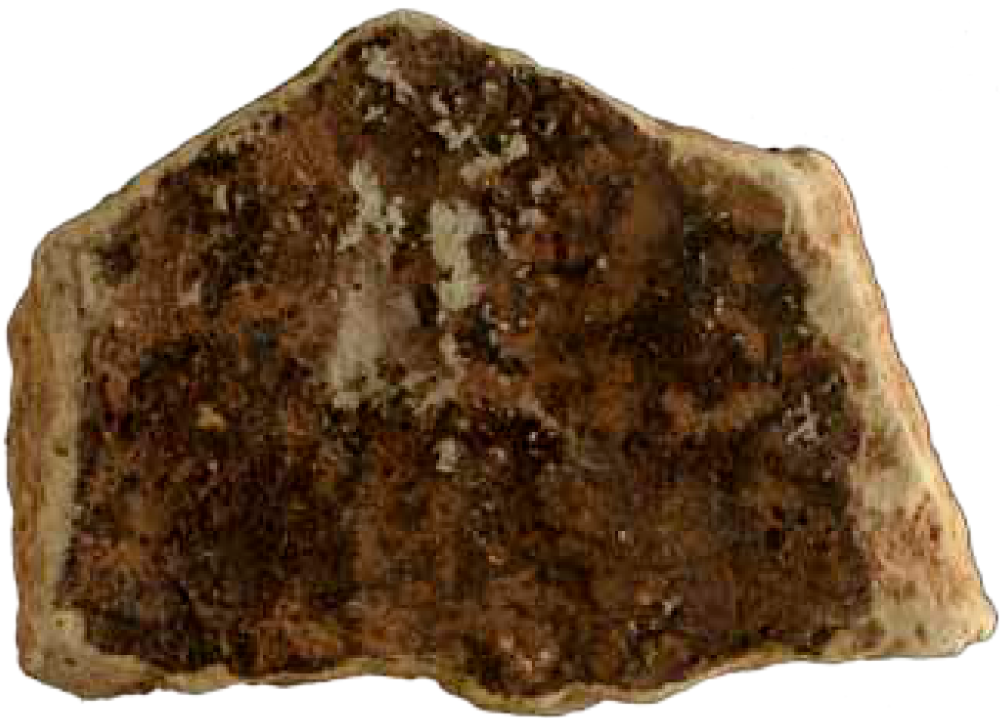 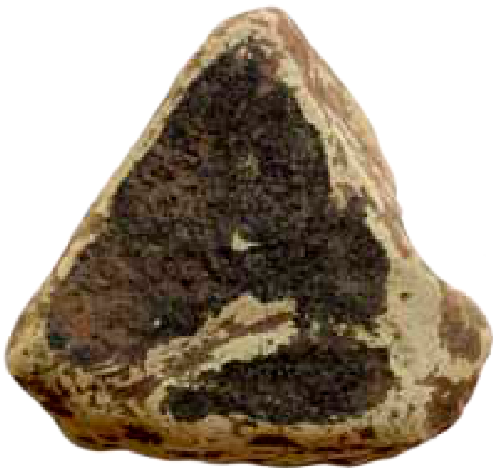

*PAMA: 53. **[Supplementary]** Two of the five torpedo jar sherds on pp. 52–53. Left: large body sherd with black lining over most of its surface. Right: triangular sherd with the lining on one face and the pale fabric visible at the edges.*

**Identification.** Body sherds of a large handleless transport jar. The black coating on the inner face is bitumen. The pale fabric shows at the broken edges.

Catalogue caption: "The majority of the torpedo jar sherds found in Pattanam have an off-white powdery fabric and a black coating of bitumen on the inner surface" (PAMA: 52). **[Supplementary] [Documented]**

Tomber describes the type: a fabric "unlike typical Indian ones, but not dissimilar to the Late Roman Amphora 1 (LR1) fabric," with "finger impressions rather than wheelmarks on the inside" (Tomber 2008: 39). The lining is diagnostic in India (p. 42). **[Documented]**

**Context.** Not published for these sherds. For the class: "Most of the torpedo jar sherds have been found from the Early Historic layers and interestingly some were from the Iron Age–Early Historic transition layers" (PAMA: 52).

**Date.** "Though the Pattanam torpedo jars are yet to be dated precisely, they could be attributed to the Parthian (3rd century BCE to 3rd century CE) and Sassanid (3rd century CE to 8th century CE) periods" (PAMA: 52). **[Supplementary]** Shajan et al. 2008 assign rare pieces to the Sasanian period by their position in the sequence. **[Documented]**

**Provenance.** Mesopotamia. "No kilns known", per the project's ware typology table, which follows Tomber. Tomber: "There is strong evidence that some of these are of Sasanian date (Tomber 2007b), but others lack secure contexts and may be Early Islamic" (Tomber 2008: 167). **[Documented and Author's interpretation]**

**Historical significance.** Torpedo jars changed the picture of who supplied India.

- "Many amphora sherds in India previously thought to be Roman have been shown to be Mesopotamian Torpedo jars" (Tomber 2008: 167).
- Torpedo jars "have not yet been identified along the Red Sea coast" (p. 167).
- Pattanam's excavated count is large: 3,098 sherds in 2007–2011 (Cherian 2012: 25) and 4,110 by 2015 (Cherian 2015: 750). When Tomber surveyed India in 2007, Pattanam had "approximately seven" (Tomber 2007: 980). **[Supplementary]**

**Limitations.**

1. **One published count is wrong.** A later synthesis gives "about 398" torpedo sherds for 2007–2014 (Nair 2021–22: 516, citing Cherian ed. 2015). That is inconsistent with both KCHR tables, which give 3,098 to 2011 and 4,110 to 2015, and should not be used. **[Supplementary]**
2. **There is no context for any illustrated sherd.**
3. **The early-trade argument stands on disturbed layers.** PAMA's argument that the transition-layer torpedo jars show "that the trade with West Asian, South Arabian and Mesopotamian regions had preceded that with the Mediterranean by at least two to three centuries" (PAMA: 52) rests on a few sherds at a site whose excavators write that "very few artifacts are recovered from the primary context" (Cherian 2011, abstract of Majeed et al.).

**My interpretation.** The decisive point is the vessel's own date. Torpedo jars first occur "in assemblages of the later Parthian (c. AD 0–224) or early Sasanian (AD 224–379)" periods (Tomber 2007: 974). **[Supplementary]** A torpedo jar cannot show trade two to three centuries before the Mediterranean trade, whatever layer it is found in.

The clearest stratified comparison is Tissamaharama, where the stratigraphy is far better. There, torpedo jar fragments "were found later than 3rd century C.E., mainly after 500 C.E." (Schenk 2014: 98). **[Documented]** If Pattanam truly had torpedo jars before the Mediterranean trade began, it would be anomalous against every other dated sequence in the readings.

The economical reading is that the transition-layer torpedo sherds at Pattanam are intrusive, carried down by the pits the excavators describe. That reading is testable: the sherds' loci, and whether they are worn and isolated or joining, would decide it. Until then, Pattanam's torpedo jars are best treated as evidence of a Gulf connection *after* the Periplus, a continuation and not a precursor. This is the substance of Part 4, argument 3.

---

## Object 12. A local storage jar rim inscribed in Tamil-Brahmi, Pattanam

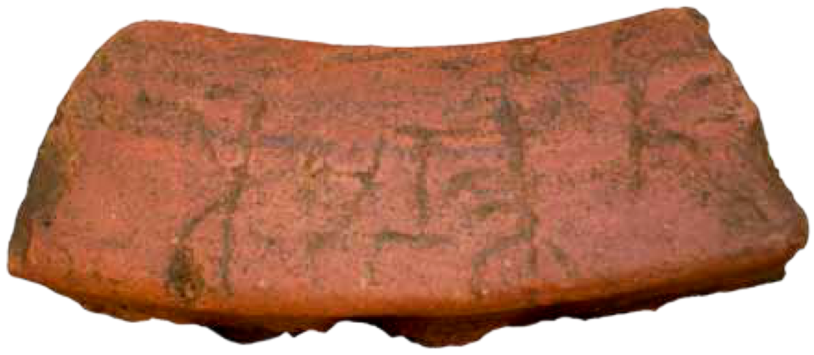

*PAMA: 32. **[Supplementary]** "Tamil-Brahmi script on sherd / There are 5 letters in this Tamil-Brahmi inscription scratched on a potsherd. The 4th and 5th letters are not clear and have been understood as 'te' and 'kei' respectively. The word has been read as 'amana' and the link may be the word 'amanen' meaning a senior Jain monk. The style of the letters allows the script to be dated to the 5th century CE."*

**Identification.** A thick, red, wheel-made rim and shoulder fragment of a large vessel, probably photographed inverted, with letters scratched after firing. The vessel is described as "a large (local) terracotta pot" (PAMA: 2) and "the rim of a local pot" (Cherian 2011: 4). **[Supplementary]** It is local utilitarian pottery: a storage vessel made in the region.

**Context.** The 2011 season: "This season produced two sherds with post firing Brahmi letters. The five letters found on the rim of a local pot were deciphered as 'a' 'ma' 'na' 'tai'(?). According to Dr. Iravatham Mahadevan, 'a ma na' meaning Jaina ... the discovery is an evidence for the presence of Jainism on the west coast of India at least from the 2nd c CE. The stratigraphic context of the rim is in agreement with the above assumption" (Cherian 2011: 4). **[Supplementary] [Documented]** Trench and layer are not published.

**Date.** The sources disagree. PAMA says "5th century CE" on letter forms. Cherian 2011 says "at least from the 2nd c CE", with stratigraphy said to agree. The readings of the last letters also differ.

**Provenance.** Local manufacture. The inscription was added by a user.

**Historical significance.** This is a local pot carrying a personal or institutional label in the regional script. The same script, written the same way (scratched after firing, on the rims of storage jars), appears abroad:

- at Myos Hormos, on an Indian storage jar (Tomber 2008: 74–75, fig. 13);
- at Berenike, "etched on a Roman amphora of the common Dressel 2-4 type, suggesting that Indians had access to Roman pots" (Tomber 2008: 74);
- at Sumhuram, on "un tesson d'amphore remployé comme couvercle (SUM06B ; US206,9)", an amphora sherd reused as a lid (Avanzini 2014: 491, n. 10, reporting the reading by K. Rajan). **[Supplementary]**

Tomber: "Graffiti in Indian languages strongly imply that Indians were living at Red Sea sites" (2008: 73). **[Author's interpretation]**

**Limitations.** The date is disputed by three centuries between two publications of the same excavation. The reading is uncertain. The Jain interpretation depends on the reading. No layer is published.

**My interpretation.** The inscription is less important for what it says than for where it sits. At Pattanam it labels a locally made storage jar. At Myos Hormos the same habit labels an Indian storage jar. At Berenike and Sumhuram it is written on Mediterranean amphorae or their fragments. Writing Tamil-Brahmi on the rim of a jar was a practice of the people who handled the goods, and it travelled with them, adapting to whatever container was at hand.

Unlike the imported fine wares, this practice runs from Malabar outwards. On the earlier date (2nd century AD), the Pattanam rim is roughly contemporary with the Red Sea graffiti, which Tomber dates "to around the first century AD" (2008: 73). On the later date (5th century), it shows the practice persisting after the Roman trade. Either way it places literate south Indian handlers of storage vessels at both ends of the route.

---

# Part 3. The scholarship

## 3.1 The critique of Wheeler

**What Wheeler did.** At Arikamedu in 1945, Wheeler identified 38 sherds of sigillata, all of which he took to be Arretine, and 116 Roman amphora sherds. On them he built a three-phase sequence (pre-Arretine, Arretine and post-Arretine), and he treated the site as an Indo-Roman trading station "which flourished largely within the first two centuries of the Christian era" (Tomber 2008: 134; Schenk 2006: 125). **[Reported]** He took Rouletted Ware to be Roman: its rouletting "resemble[s] closely the decoration of the Arretine ware," and "most believed RW to be a Roman import" (Schenk 2006: 126).

**What has been overturned, and by whom.**

1. **Begley (1983 onward) redated Arikamedu** as a long-lived site, "reoccupied, intermittently, from the third century B.C. up to modern times" (Schenk 2006: 126, reporting Begley 1996: 8, 30). This is the foundation every other reading builds on.
2. **Comfort and Slane re-sourced the sigillata** to Italy, Syria (ESA) and western Asia Minor (ESB), dated c. 10 BC – AD 50 (Tomber 2008: 136). Wheeler's single "Arretine" phase dissolves.
3. **Schenk, from Tissamaharama, redated Rouletted Ware** to the third to first centuries BC, made in northern India (Schenk 2006: 141; 2014: 105). "RW does not indicate Indo-Roman trade" (2006: 141).
4. **Tomber removed whole categories from the Roman column.** Torpedo jars are Mesopotamian, Red Polished Ware is Indian, and several "Roman amphorae" in Bengal and Orissa are post-Roman or local (2008: 129, 167).

**How strong the critique is in each author.** Schenk is the most direct. She opens with H. P. Ray's "Old myths die hard" and writes of "the uncritical reliance on half a century old publications" (2006: 123). Pavan and Schenk are milder: they name Wheeler as the start of a Roman-centred tradition but use his type numbers throughout, and credit him with distinguishing local from imported clays (2012: 191, 194). Tomber is careful. She corrects identifications case by case and frames the issue as definitional: "Conventionally, in the south a terminal date of AD 300 has been adopted, but this is largely based on what has been considered the end of the Roman contact period" (2008: 120). Cherian puts it most strongly: "Earlier perspectives (colonial) ... projected Indian port sites as Roman sites or at the most as Indo-Roman sites! The Pattanam site needs to be understood primarily as an Indian site with Roman or West Asian connections" (Cherian 2012: 28). **[Supplementary]**

**What survives of Wheeler.** His typology remains the reference system. Wheeler type 1 is Rouletted Ware, and types 10, 18 and 24 recur throughout this document. And the Roman peak he identified is real at Pattanam (object 7), though it is now one phase in a longer sequence rather than the sequence itself.

## 3.2 Pre-Roman maritime exchange

**Established.**

- **Indian fine wares moved before the Roman period.** Rouletted Ware and its relatives were produced between the third and first centuries BC (Schenk 2006: 141).
- **They reached Sumhuram in South Arabia, the Red Sea and Southeast Asia** (Schenk 2006: 131, fig. 4; 2014: 98, fig. 3).
- **The routing predates Rome.** Schenk 2014 draws "long-distance routes across the Indian Ocean in the 2nd century B.C.E." and says the routing "predat[es] the Roman time" (2014: 98).
- **Pavan and Schenk, at Sumhuram:** "definite archaeological proof that there were links between South Asia and the port city, links that predated the period of trade recounted in the Periplus" (2012: 198).
- **Tomber agrees in principle,** citing two vessels of Red-and-Black Megalithic Ware at Myos Hormos that "hint at pre-Roman contact" (2008: 75).

**Disputed or weaker than it looks.**

1. **How much earlier, and where the evidence was found.** The Sumhuram Rouletted Ware is the *late* group (object 1). Some of it is in surface or later layers. The oldest Sumhuram layers are mixed (Avanzini 2014: 498). And Sumhuram's dates are borrowed from Tissamaharama.
2. **Curation.** Tomber notes that if Schenk's dating is strictly applied, "some sherds were curated before being discarded" (2008: 74). Curation weakens the use of Rouletted Ware as a terminus for founding dates.
3. **At Pattanam,** the claim that Gulf trade preceded Mediterranean trade "by at least two to three centuries" (PAMA: 52) rests on a few sherds in disturbed transition layers (object 11).

**Unresolved.** Whether there was pre-Roman maritime traffic *from Malabar specifically*. No object in the readings ties pre-Roman exchange to the Malabar coast. Schenk 2006: 132 even suggests Pattanam was reached overland from the east coast "via Kodumanal on the route along the Kaveri river". Schenk 2014: 113 notes Pattanam as the one west-coast exception to the general absence of Fine Grey Pottery. Pavan and Schenk 2012: 200 go furthest, naming "the region around Muziris" as the nexus at the time of Rouletted Ware. But they offer no Malabar object in support.

## 3.3 Indigenous commercial agency

**Established.** Indian pottery at the Red Sea ports is overwhelmingly utilitarian and associated with people:

- cooking pots, sooted (Tomber 2008: 46);
- storage jars, including the pepper jar (p. 75);
- Tamil-Brahmi and Prakrit-Brahmi graffiti (pp. 73–75).

Tomber reads this as Indian communities, not trade in ceramics (p. 74). Pavan and Schenk extend the argument to Sumhuram (2012: 200). Schenk 2007 records, on Sidebotham's authority, that "since Hellenistic times, the actual entrepreneurs of the trade were South Arabs, Indians, Chinese and other 'Easterners'" (2007: 63). **[Reported]**

**Disputed.** Whose agency moved the fine wares. Schenk's answer is northern and political: the Mauryan state, Buddhist institutions, and the diplomacy between Asoka and Devanampiya Tissa. She herself flags it as "highly speculative" (2006: 139; 2014: 113). Tomber and Pavan prefer personal possessions or gifts. Neither explanation is tested by any object.

**Unresolved.** South Arabian agency. Pavan and Schenk treat Sumhuram as a receiver of Indian goods. Avanzini 2014 makes it an instrument of Hadrami state policy, "un port destiné au commerce avec l'Inde" founded in the third century BC (p. 498). **[Supplementary]** The ceramic evidence for who carried goods between Arabia and India is thin in both directions.

## 3.4 Overlapping regional networks

**Established.** Three ware groups have different distributions:

- **Mesopotamian glazed ware and torpedo jars** occur in the Gulf, South Arabia, India and Sri Lanka. Torpedo jars are absent from the Red Sea (Tomber 2008: 167).
- **Rouletted Ware** occurs on the Red Sea, in South Arabia, India, Sri Lanka and Southeast Asia, but "not traced at the Gulf sites" (Schenk 2007: 65).
- **Italian sigillata and ESB** occur on the Red Sea, in South Arabia, at Ed-Dur, and at Arikamedu and Pattanam, but are otherwise absent in the Gulf (Schenk 2007: 64, reporting Rutten 2007).

**Disputed.** What the distributions mean for routing. Schenk 2007, building on Rutten, argues that "the Gulf routing had lost its relevance with regard to direct oversea connection, but trade still continued via the South Arabian ports" (2007: 64). Ed-Dur thus received Roman goods through South Arabia, not up the Gulf. Tomber records that at Ed-Dur "Mesopotamian Glazed Ware and Torpedo jars [are] much more common" than Roman pottery, and that "the lack of Indian pottery is notable" (2008: 111). Those two facts fit a Gulf world that touched the Roman one through intermediaries.

**Unresolved.** When the networks overlapped at Pattanam. Pattanam has all three groups. Whether they were contemporary there, or successive, depends on dating the Mesopotamian material (objects 10 and 11), which has not been done sherd by sherd.

## 3.5 Ports as intermediaries

**Established.** South Arabian ports as transhipment points: "The South Arabian ports served as reloading points" (Schenk 2007: 70). Tomber: "The journey between India and Arabia can be traced by the robust Indian ceramic assemblages at both Qana and Khor Rori" (2008: 158). Sri Lanka reached the western trade "via South India and middlemen such as the Pandyans" (Schenk 2007: 70, reporting Walburg and Weerakkody).

**Disputed.** Whether the southern tip of India was a single emporium. Schenk 2014 argues that "an emporium had formed in the course of time because favourable sailing conditions allow direct contacts of Western and Eastern Indian Ocean" (p. 95) in the south. Pavan and Schenk name Muziris. Neither identifies an archaeological signature that would distinguish an emporium from a port of call. Schenk's proposal is the imitation dish (object 3).

**Unresolved.** Pattanam's role. Shajan et al. 2008 compare its pottery with "the major ports for Indian Ocean commerce" and conclude that "its location would have accommodated a port." Their range of imports was "smaller and more reduced" at that date. Whether Pattanam was a terminal (where goods were consumed), an intermediary (where goods changed hands for onward shipment), or both is open. Part 4, arguments 2 and 3, bear on it.

## 3.6 Where the scholars disagree, in one table

| Question | Position A | Position B | State of evidence |
|---|---|---|---|
| Where Rouletted Ware was made | Northern India, Ganges plain (Schenk 2006: 140; Gogte, reported) | South India, single source such as Arikamedu (Ardika et al. 1993, reported by Schenk 2006: 134); locally at Pattanam (PAMA: 92) | No kiln. Provenance studies disagree with each other on sampling grounds |
| When Rouletted Ware was made | 3rd–1st c. BC (Schenk 2006: 141) | Into the 4th c. AD (Nagaswamy 1995, reported by Schenk 2006: 123) | Tissamaharama stratigraphy favours A, but curation blurs it |
| Why fine wares travelled | Personal possessions of Indians abroad (Tomber 2008: 74) | Gifts to people of rank; Mauryan and Buddhist networks (Schenk 2006: 139; Pavan and Schenk 2012: 200) | Untested |
| Date of Mesopotamian glazed ware in South Asia | Parthian, 1st c. BC – 1st c. AD (Schenk 2007: 62) | Sasanian (Shajan, Selvakumar and Tomber 2005, reported by Schenk 2007: 58; Shajan et al. 2008) | Depends on fabric and context. Schenk's Parthian case rests on one backfill |
| Gulf trade before Mediterranean at Pattanam | Yes, by two to three centuries (PAMA: 52; Cherian 2012: 27) | Torpedo jars Sasanian and later (Tomber 2007: 980–981; 2008: 167; Schenk 2014: 98 at Tissamaharama) | The vessel type begins c. AD 0 (Tomber 2007: 974). Only turquoise glazed ware could carry the claim (Part 4, argument 3) |
| Mediterranean residents at Indian ports | Yes: Wheeler's *Yavana* quarter at Arikamedu (reported by Pillai 2010: 2); amphorae "for resident merchants" (PAMA: 47); Nair 2021–22: 535 | Roman goods for local elites (Tomber 2010: 48, Welwyn analogy); no organised enclaves (Cobb 2023: 371) | Indians abroad leave cooking pots; no Mediterranean kitchenware reported at Pattanam (Part 4, argument 2) |
| Repair as a sign of value | Yes (Schenk 2006: 137; Pavan and Schenk 2012: 200) | No (Salles, Boussac and Breuil 2002, reported by Schenk 2006: n. 42) | Unargued on either side |

---

# Part 4. Three arguments

Each argument starts from a disagreement that is live in the scholarship and says what turns on it for the thesis question. It then brings the specific objects and counts to bear, separates what is documented from what is mine, and ends with what would decide the matter.

Three sources not used elsewhere in this document carry much of the weight here, and are marked **[Supplementary]**:

- **Cherian 2015**, the ninth-season report. It gives the consolidated counts for 2007–2015 and the position of every trench.
- **Tomber 2007**, on torpedo jars in India.
- **Cobb 2023**, on Indian merchants abroad.

The trench positions are transcribed in `../material/data/excavations/pattanam_trenches.csv`.

The earlier draft of this part had five arguments. Their material is not lost: the curation problem is now inside argument 1, and the sigillata counts and the Kerala cooking pots are inside argument 2. The point about imitation is in the leads at the end. One claim in that draft was wrong and is corrected in argument 2: that the 2011 sigillata came from trenches 500 m from the wharf.

---

## Argument 1. The pottery proves a South Asian network before Rome, but not a crossing of the Arabian Sea before Rome

*This argument has been tested against a wider search in `arabian_sea_crossing.md`. The result sharpens it. Indians did cross the Arabian Sea before Rome, but from north-western India. South India, Malabar included, appears in Arabian and Red Sea archaeology only from the late first century BC.*

**The disagreement.**

- **The old view.** Roman demand created the ports. Wheeler's Arikamedu was a Roman "trading station", and Cobb traces the same assumption back to Warmington (Cobb 2023: 366–367). **[Supplementary]**
- **The revision.** Rome joined a network that already existed.
  - Schenk draws "long-distance routes across the Indian Ocean in the 2nd century B.C.E." (Schenk 2014: 98).
  - Pavan and Schenk claim "definite archaeological proof" of links between South Asia and Sumhuram "that predated the period of trade recounted in the Periplus" (2012: 198).
  - Avanzini, who directs the Italian Mission at Sumhuram, writes of "a continuity in relations from the 3rd century BC". She places Rouletted Ware "in strata that can be dated to when the city was first inhabited" (Avanzini ed. 2011: 102–103). **[Supplementary]**
  - Cobb is more careful. He describes "a major phase of sustained integration between the Arabian Sea and Bay of Bengal spheres". He says a second-century BC start for Rouletted Ware "might seem to support" the dating of that phase (Cobb 2023: 381–382). **[Supplementary]**

**What turns on it.** If ships crossed between India and Arabia before Rome arrived, Malabar was already in a working network when the Periplus was written, and Roman demand added to an existing importance. If they did not, Malabar's rise and the Roman trade are the same event, and the answer to "what made Muziris important" is mostly Roman after all.

**The evidence, one leg of the voyage at a time.** The revisionist case treats "the network" as one thing. The pottery separates it into two legs, and they are not equally well evidenced.

*The eastern leg, from northern India to southern India and Sri Lanka, is proven.* At Tissamaharama, Trench 3B, Phase c1 (second century BC), Rouletted Ware lies as rims mended from joining sherds (Figure 15; Schenk 2014: 102). **[Documented]** Joining sherds in one deposit mean a vessel broke where it was used. Fine Grey Pottery from the north reaches the site from Phase b, the third century BC (Schenk 2014: 106). Nothing in the readings challenges this.

*The western leg, across the Arabian Sea, is not proven before Rome.* These are all the objects in our sources that could show a pre-Roman crossing, with what each can and cannot carry:

| Object | Date offered | What limits it |
|---|---|---|
| Three true Rouletted Ware sherds, Sumhuram (object 1) | Late group: at Tissamaharama, discarded "not before late Phase c1 (towards the end of the second century BC)" (Pavan and Schenk 2012: 196) | One was found near the surface and the base in a later stratum (pp. 193, 197). The date is borrowed from Tissamaharama. Rouletted Ware was kept and mended into the early first century AD (object 2) |
| Wheeler type 18 base, room A30, Sumhuram, with two Yashhuril coins (object 4) | Coin layers "datable to the second century BC" (Pavan and Schenk 2012: n. 7, citing Sedov 2008c) | Avanzini makes Yashhuril a "roi de la deuxième moitié du Ier siècle av. J.-C." (2014: 498). A summary of Sedov's 2022 paper on two coins from Mleiha, seen only through a web search, puts a Yashhuril Yuharʿish coin in the late second to early first century BC **[Web, unverified]**. The coins' date range straddles the boundary that matters. The article also lists this base among finds from "later contexts" (p. 198) |
| The oldest layers at Sumhuram | "poterie indienne d'av. J.-C." | They also contain "amphores du Ier siècle av. ou ap. J.-C." (Avanzini 2014: 498). Avanzini attributes the mixing to Yashhuril's rebuilding of the town |
| About 20 Indian fine-ware vessels, Red Sea ports | From the late first century BC | They lie in late first-century BC and first-century AD contexts, so "some sherds were curated before being discarded" (Tomber 2008: 74) |
| Two Megalithic Red-and-Black vessels, Myos Hormos | They "hint at pre-Roman contact" (Tomber 2008: 75). Possibly Ptolemaic (Cobb 2023: 376) | No context date is given in the readings. This is the one object that could break the pattern |
| 84 South Arabian sherds at Pattanam, 39 of them ovoid jars (Cherian 2015: 751) | The ovoid jar is "common in South Arabia, especially in Hadramawt from the 3rd century BCE onwards" (PAMA: 54) | The type's range is open-ended and no sherd has a context |

**[Documented]**, **[Reported]** and **[Supplementary]** as cited in the table.

**My argument.** Look at every object in the table that has a context. Each one shares that context with first-century BC or AD material, or carries a date borrowed from Tissamaharama, where the same ware is known to have been kept for generations. Not one lies in a sealed deposit older than the earliest Roman material at the same site.

The pottery therefore proves a South Asian exchange network before Rome on the Bay of Bengal leg. It is *consistent with* a crossing of the Arabian Sea before Rome, but does not demonstrate one. The crossing first becomes securely visible in the late first century BC, in the same horizon as the Roman amphorae.

**Two readings of the Sumhuram layers, and how to tell them apart.**

- **Avanzini's reading.** The crossing is older, and its early deposits were churned when Yashhuril rebuilt the town. Churning should leave worn, isolated Indian sherds scattered through rebuilding fill. That is the Phase c2 pattern in Trench 3B.
- **The curation reading.** Indians crossed around the time Rome arrived, bringing old tableware. Vessels that arrived whole and broke on site should leave at least some joining fragments in one deposit. That is the Phase c1 pattern.

Pavan and Schenk's own criteria, mendability and wear, decide between them. They applied those criteria at Tissamaharama and did not report them for Sumhuram.

**Where this sits in the scholarship.**

- Tomber noticed the curation problem at the Red Sea ports (2008: 74). Cobb hedges for the same reason.
- What is added here is the location of the uncertainty. The question is not whether exchange existed before Rome; it plainly did. It is on which leg.
- The Malabar coast sits exactly where the two legs meet. Schenk even suggests Pattanam was reached overland from the east coast, "via Kodumanal on the route along the Kaveri river" (Schenk 2006: 132). If so, Malabar's pre-Roman connections may have run east by land, not west by sea.

**What would decide it.**

1. **The Sumhuram unit records** for the Rouletted Ware and the Wheeler 18 base: joins, wear, and what else is in each unit (Buffa and Sedov 2008; Sedov 2008a).
2. **The coin date.** Sedov 2008c and Sedov 2022 on the Yashhuril coinage. This is decidable from published numismatics.
3. **The Myos Hormos Red-and-Black vessels.** Their context and date, in the Myos Hormos final reports.
4. **The 848 "Pattanam–Khor Rori ware" sherds** (Cherian 2015: 751). Their source is still listed as unidentified; see the leads at the end of this part.

---

## Argument 2. Indians lived in the Roman ports; the pottery does not show Romans living at Pattanam

*Superseded by `argument2_westerners_at_muziris.md`, which adds the textual evidence (the Temple of Augustus, the Muziris papyrus, Periplus 56, the Tamil poems) and the wheat and grape remains from the Pattanam wharf.*

**The disagreement.** Did people from the Mediterranean live at Indian ports, or did Roman goods reach Indian consumers?

- **For residents:**
  - Wheeler's northern sector at Arikamedu, read as a *Yavana* quarter, reported by Pillai (2010: 2, 5). **[Supplementary]**
  - PAMA: amphorae were "likely to have been for resident merchants and traders from the West, as well as for local elites" (PAMA: 47). **[Supplementary]**
  - Nair: West Asian ceramics "have proved the presence of foreigners in the west coast of Kerala" (Nair 2021–22: 535). **[Supplementary]**
- **Tomber holds both possibilities open, by two English analogies** (Tomber 2010: 48). **[Supplementary]**
  - Pre-Roman Colchester. There, "a small amount of imported amphorae, sigillata and glass may represent the needs of a resident foreign (Roman) community."
  - Welwyn. There, the same goods went into the graves of local aristocrats. "Similarly in India, amphorae may have been restricted to wealthier segments of indigenous society."
- **Cobb is sceptical of enclaves.** "The evidence for the ancient Indian Ocean is too sparse to attest to organized, diplomatically agreed trading enclaves" (Cobb 2023: 371). **[Supplementary]**

**What turns on it.** A port with a foreign colony is important because outsiders chose to live there. A port without one is important because local people ran the exchange: they unloaded, stored, financed and supplied ships that came and went with the season. The thesis question needs to know which.

**The test.** Cobb supplies a criterion. How food is "prepared, served and eaten" tracks group identity, and coarse wares are "culturally restrictive personal possessions" that people carry when they live abroad (Cobb 2023: 370, 376). **[Supplementary]** The argument here applies that criterion in both directions.

**Indians in the Roman ports pass the test.**

- Coarse Red-Slipped Ware cooking pots, sooted and wiped inside with bamboo, occur at Berenike, Myos Hormos and Koptos. They also occur at Sumhuram, Qana and Ras al-Khaimah (Cobb 2023: 376; Tomber 2008: 46–47; object 6).
- South Asian foods are present: rice, including de-husked rice, mung beans, coconut and gooseberries (Cobb 2023: 376).
- Personal names are written in Tamil-Brahmi on an Indian storage jar at Myos Hormos, on a Dressel 2-4 at Berenike, and on a reused amphora sherd at Sumhuram (Cobb 2023: 375–376; Tomber 2008: 74–75; object 6).
- A 2025 study adds Buddha statuettes and a Sanskrit–Greek dedication of AD 248 at Berenike. That is later than the Periplus. It is known here only from its abstract (Sidebotham et al. 2025). **[Web, abstract only]**

**Mediterranean people at Pattanam do not pass it.** By 2015 the Mediterranean material at Pattanam was (Cherian 2015: 750–751, unless noted) **[Supplementary]**:

- 9,125 amphora sherds;
- 179 sigillata sherds;
- 2,699 glass fragments, of which 102 are "Roman pillared" glass;
- three glass gaming counters;
- cameo blanks and intaglios;
- in 2020, a miniature Greco-Roman head and a Sphinx intaglio from one trench (PAMA 2020: 2–3).

None of the reports we hold records a Mediterranean cooking pot, casserole or mortarium at Pattanam. The lamps are terracotta, and the reports list them among the local terracotta objects (Cherian 2011: 4), 97 by 2015 (Cherian 2015: 754). Every Mediterranean class at Pattanam is drink, tableware, glass or gems. These are exactly the goods that Tomber's Welwyn analogy has local elites acquiring. None of them is a kitchen.

**The sigillata, corrected.**

- **Counts.** By season the sigillata counts are 2, 7, 0, 2 and 111 for 2007–2011 (Cherian 2012: 25). By 2015 the total was 179 (Cherian 2015: 750), so 2012–2015 added 57 more. The 2011 season holds 62 per cent of the total, not the 91 per cent the earlier draft implied.
- **Location.** The 2011 trenches were not all in one place. Cherian 2015's trench table puts four of them (PT11 XXVIII–XXXI) on the Padamadathil plot, about 125 m from the wharf plot. The other six (PT11 XXXII–XXXVII) are at Madathilparambu, about 500 m away (Cherian 2015: 742; `pattanam_trenches.csv`). Only the second group fits the "500 m" in Cherian 2011: 1.
- **What that means.** A season total cannot be assigned to either group. The claim that the sigillata clusters in one sector is unsupported until the trench-by-trench counts are seen.
- **Proportion.** Sigillata runs at about 2 sherds per 100 amphora sherds overall.

**My argument.** On the test that establishes Indian residents in the Roman ports, the case for Mediterranean residents at Pattanam fails on present evidence. The movement of people was asymmetric:

- Indians, including people using Kerala-made pots, lived and cooked in Egyptian and Arabian ports.
- The Roman presence at Pattanam is visible only as consumption, which local buyers would account for as well.

PAMA's own epigraph points the same way. *Akanāṉūṟu* 149 describes Yavana ships that "come with their fine ships, bearing gold, and leave with pepper" (PAMA: 28). Those are visitors, not settlers. **[My interpretation]**

**Where this sits in the scholarship.**

- Tomber and Cobb have made the case for Indians abroad.
- PAMA, Pillai's account of Wheeler, and Nair assert foreigners in India.
- Tomber 2010 leaves the question open.
- No one in the readings has applied the same test to both ends. That symmetry is the contribution here.

**The weaknesses, stated plainly.**

1. **Absence may be non-recognition.** The Pattanam reports count imports by broad class, and Mediterranean coarse wares might be sitting among the 124,302 "unidentified" sherds (Cherian 2015: 751).
2. **Visitors may have cooked in local pots.** Then the asymmetry would record cooking habits, not where people lived.
3. **The Kerala attribution of the Red Sea cooking pots rests on technique, not clay** (object 6). Cobb notes the type "was not exclusive to southwest India" (2023: 376).

**What would decide it.**

- Tomber's full identification of the Pattanam Mediterranean assemblage by form. She studied the 2010 and 2011 material (Cherian 2011: 5). Does it include any coarse or cooking ware, or any Mediterranean lamp?
- Trench-by-trench counts of sigillata, glass and gaming counters from the KCHR records, mapped with `pattanam_trenches.csv`.
- Use-wear on the sigillata. Worn foot-rings and cut marks mean dishes that were used, by whoever used them.
- **For the voyage model,** the length of the forced wait at each end of the voyage. If ships had to wait much longer at the Egyptian end than at the Malabar end, the timetable alone could produce resident Indian communities in Egypt and only seasonal visitors in Malabar. This is a question the simulator can answer.

---

## Argument 3. Pattanam's largest Gulf assemblage almost certainly postdates the Periplus, and its "Early Historic" period is too long to show otherwise

**The disagreement.**

- **The excavators' view.** Torpedo jars in the Iron Age to Early Historic transition layers show "that the trade with West Asian, South Arabian and Mesopotamian regions had preceded that with the Mediterranean by at least two to three centuries" (PAMA: 52; Cherian 2012: 27). **[Supplementary]**
- **The view from dated sequences.** Torpedo jars in India are Sasanian, from AD 224, or Early Islamic (Tomber 2007: 980–981; Tomber 2008: 167). At Tissamaharama they appear "later than 3rd century C.E., mainly after 500 C.E." (Schenk 2014: 98).

**What turns on it.** If the Gulf trade came first, Pattanam was an Arabian Sea port before it was a Roman one. If it came later, Pattanam stayed important after the Roman trade peaked. Either way, the port's importance does not reduce to Roman demand, but the two sequences mean different things for what the Periplus is describing.

**The evidence.**

1. **When the vessel type existed.** Torpedo jars occur first "in assemblages of the later Parthian (c. AD 0–224) or early Sasanian (AD 224–379)" periods. At ʿĀna on the Euphrates they appear "in small numbers during the later Parthian phase", with their "zenith during the Middle Sasanian period (fourth/fifth centuries)" (Tomber 2007: 974). **[Supplementary]** PAMA attributes the Pattanam jars to "the Parthian (3rd century BCE to 3rd century CE)" period (PAMA: 52). That bracket is the span of the dynasty, not of the vessel.

2. **The layers.** PAMA dates the transition period to c. 500–300 BC (PAMA: 16); Cherian 2011: 2 gives the second to fourth centuries BC.
   - A torpedo jar in such a layer has either been carried down from above or the layer is misdated. It cannot show Gulf trade two to three centuries before the Mediterranean trade.
   - The excavators met the same problem in the 2007 trial trenches. They found "a few Early Historic ceramics" in the transition layers, "most probably due to disturbance" (Selvakumar, Shajan and Tomber 2010: 33).
   - In 2015 they wrote of the Iron Age layers that "their conflation with the Early Historic layer can't be ruled out" (Cherian 2015: 745). **[Supplementary]**

3. **The scale.**
   - When Tomber wrote, Pattanam had "approximately seven sherds from torpedo jars", mostly from surface collection. Only "two of the torpedo sherds are from excavated layers" (Tomber 2007: 980).
   - Her table of every Indian find-spot gives about 375 published sherds at seventeen other sites, plus an unquantified number at Sanjan (Tomber 2007: 978, Table 1; my sum).
   - By 2015 Pattanam had **4,110** torpedo sherds (Cherian 2015: 750), about 45 for every 100 amphora sherds. The count "about 398" for 2007–2014 (Nair 2021–22: 516) is inconsistent with every KCHR table and should not be used.
   - Tomber mapped torpedo jars as a phenomenon of Gujarat and the Konkan, clustered in the territory of the Western Kshatrapas (2007: 982). On the Pattanam counts, Kerala now outweighs that whole distribution. Nobody in our readings has re-run her map with them. **[My interpretation]**

4. **Torpedo jars and amphorae come out of the same deposits.** Torpedo sherds per 100 amphora sherds, by season (Cherian 2012: 25; Cherian 2015: 750; 2012–2014 by subtraction), were:

   | Season | 2007 | 2008 | 2009 | 2010 | 2011 | 2012–14 | 2015 |
   |---|---|---|---|---|---|---|---|
   | Torpedo sherds per 100 amphora sherds | 28 | 55 | 25 | 35 | 71 | 33 | 26 |

   The two classes rise and fall together with the volume dug. They are not separated in time by the excavation.
   - The commonest amphora, Dressel 2-4, dates from the late first century BC to the late first century AD (Tomber 2010: 48).
   - The torpedo jars, on every dated comparandum, are mostly third century AD or later.
   - So the deposits that yield both span centuries. That fits how the excavators define the period: "Early historic period (300 BCE to 500 CE)" (Cherian 2015: 745).

5. **The comparanda.**
   - At Tissamaharama, 26 torpedo sherds: one in Phase e (third century AD), one in Phase f, and thirteen in Phase g (AD 450 to the sixth century) (Tomber 2007: 981, Table 2).
   - At Anuradhapura the earliest are from periods dated AD 200–600 (Tomber 2007: 981).
   - At Pattanam itself, a glazed sherd with appliqué decoration "may date from between the eighth and tenth centuries and suggests that at least some of the torpedo sherds may be early Islamic in date" (Tomber 2007: 980).

6. **Turquoise glazed ware is the exception.** It was made in the Gulf "from at least the third century BC" (Tomber 2007: 975), and Schenk makes a Parthian case at Tissamaharama (object 9). It is therefore the only Gulf ware that could carry a pre-Roman claim at Pattanam. Pattanam has 2,219 sherds by 2015 (Cherian 2015: 750), dated by PAMA only to between "the 3rd century BCE and 8th century CE" (PAMA: 57).

**My argument.** Three conclusions follow, in descending order of confidence.

1. **The claim that Gulf trade preceded Mediterranean trade at Pattanam cannot rest on torpedo jars.** The vessel did not exist two to three centuries before the Mediterranean trade, so transition-layer torpedo sherds are intrusive whatever their number. If the claim survives, it survives on turquoise glazed ware alone, and that needs its fabric sorted.
2. **If the torpedo jars are mostly Sasanian or later,** as every dated sequence in the readings implies, then Pattanam's largest foreign assemblage after the amphorae postdates the Periplus. On this reading, Pattanam faced the Gulf for longer than it faced Rome. Its Roman peak was one phase in a long history as a port, not the reason it existed.
3. **As published, Pattanam's "Early Historic" period is an 800-year unit, and its imports come out of it mixed.** Being found in Early Historic layers says almost nothing about date. The only Pattanam material that is specific to the Periplus horizon is the amphorae dated by type: Dressel 2-4, and the Campanian vessels made before AD 79 (object 7).

**Where this sits in the scholarship.**

- The argument agrees with Tomber 2007 and 2008 and with Schenk's Tissamaharama sequence, and disagrees with PAMA and Cherian 2012.
- Two points are added here. The first is applying the vessel's production date directly against the transition-layer claim. The second is the scale: Tomber's distribution was drawn before Pattanam had produced more than a handful of sherds.
- Schenk 2007 sits partly on the other side. She argues for Parthian-period glazed ware arriving by way of South Arabia (pp. 64, 70). If she is right, early glazed ware at Pattanam would mark Arabian intermediaries, not a direct Gulf link.

**Why it matters for the thesis.** For the locating problem, a long-lived port is evidence of a good harbour, not of a harbour *in AD 50*. Pattanam's case for being a port at the Periplus date has to come from the amphora types and from the coastline. The project's shoreline trace already puts Pattanam about 220 m from the undated ancient shoreline in Narayana, Priju and Chakrabarti 2001.

**What would decide it.**

1. **The West Asian specialist report.** Kennet was studying "the assemblage of buff, blue and green glazed Parthian/Sasanian ceramics (Turquoise Glazed Pottery) and torpedo jar sherds" in 2011 (Cherian 2011: 5). Is it published?
2. **A fabric sort of the turquoise glazed ware,** using Schenk's criterion: sandy pale-yellow for Parthian against chalky white for Islamic (object 9).
3. **The torpedo sherds in transition layers:** the locus of each, whether they are worn, and whether any join.

---

## Leads that are not yet arguments

**Rouletted Ware at Pattanam.** The debate over where Rouletted Ware was made is open (section 3.6).

- When the first trial trenches were dug, Pattanam had "three rim sherds" and "30+" tiny body sherds. The excavators judged the fabric "distinct from the clay used for the local pottery at Pattanam ... imported from elsewhere in India" (Selvakumar, Shajan and Tomber 2010: 36).
- By 2015 the count was 12,030 sherds (Cherian 2015: 749).
- The 2015 inventory lists one "terracotta mould (Rouletted ware?)" (Cherian 2015: 754).
- PAMA calls the ware "locally produced pottery" (PAMA: 92).

If any of it was made or finished at Pattanam, Pavan and Schenk's "region around Muziris" (2012: 200) gains the Malabar object it lacks, and argument 1's eastern leg reaches the west coast by sea or by land. Two things would test this: the mould itself, and thin sections of Pattanam Rouletted Ware against the Fine Grey group. Schenk's evidence that southern potters copied the rim but never the rouletting (object 3) is the control. A local product with rouletting would be new.

**The Pattanam–Khor Rori ware.** The 2015 inventory lists 848 sherds of "Pattanam‐KhorRori ware" under "Unidentified pottery" (Cherian 2015: 751). The 2020 report places it "from the Arabian region" (PAMA 2020: 2). A ware named after both sites, of undetermined origin, is the most direct possible link between Malabar and Sumhuram. Once it is sourced and dated, it would bear directly on argument 1.

---

# Part 5. What made a port important

The thesis asks what made certain Indian Ocean ports commercially important. The ceramic case studies bear on four candidate answers.

## 5.1 Geographical accessibility

The pottery says less about physical access than about the networks a port joined. It does give three clues.

**1. Every port in this document sits back from the open sea.**

- Pattanam is "now about 4 km from the Arabian Sea coast" (PAMA: 12).
- Tissamaharama is about 12 km from the coast and "was connected to a coastal port by the Kirindi Oya River" (Schenk 2014: 99; Tomber 2008: 146, reporting Schenk).
- Adulis, in the Periplus "20 stadia from the coast", had its first-century port found only by survey away from the visible later ruins (Tomber 2008: 89–90).

The Periplus places Muziris twenty stadia up its river. A port reached by river or lagoon was the norm, not the exception.

**2. Small-boat transfer.** The Pattanam wharf, with its canoe and bollards, is the one structure in the readings directly concerned with moving goods between water and land. Its dates are less secure than the catalogue says (section 1.10).

**3. Pottery as an absence marker.** Godavaya, a coastal harbour 20 km from Tissamaharama, has no Rouletted Ware and was founded only in Phase d1 (Schenk 2006: 138). A harbour can be close to a major centre and still join the long-distance network late.

## 5.2 Regional connectivity

This is where the ceramics are strongest. Pattanam's distinction is that all three of the networks in section 3.4 reach it:

- Red Sea Roman (amphorae, sigillata);
- Gulf Mesopotamian (glazed ware, torpedo jars);
- South Asian (Rouletted Ware, possibly via the east coast).

Ed-Dur received two (Gulf and Roman) and lacked Indian pottery. The Red Sea ports received two (Roman and Indian) and lacked torpedo jars. On this evidence, commercial importance followed from being the place where networks overlapped. Argument 3 cautions that at Pattanam the overlap may have been sequential rather than simultaneous.

## 5.3 Commercial intermediaries

South Arabian ports were reloading points (Schenk 2007: 70). The Pandyans stood between Sri Lanka and the western trade (Schenk 2007: 64, 70). Sumhuram existed, in Avanzini's view, because a state founded it for the India trade (Avanzini 2014: 498).

The ceramic signature of an intermediary is mixing: goods from several origins arriving together, and some moving on. Sumhuram has that signature: Indian, Mesopotamian and Mediterranean together, with glazed wares at 30 per cent of the tableware (Schenk 2007: 61, n. 9). Pattanam has it too. Whether goods *moved on* from Pattanam is not visible in pottery, which is consumed where it breaks.

## 5.4 Roman demand

Roman demand is visible as Campanian wine at Pattanam and pepper at Berenike. It explains a peak, the first century AD, which Tomber identifies in the Pattanam amphorae (Cherian 2011: 4). It does not explain why Kerala people lived at Berenike while no Mediterranean kitchen is reported at Pattanam (argument 2). Nor does it explain why Pattanam's second-largest foreign assemblage probably postdates the Roman peak (argument 3).

The ceramic answer to the thesis question is therefore layered, and each layer has a different strength:

1. **A South Asian network existed before Rome on the Bay of Bengal leg.** This is proven. Whether it crossed the Arabian Sea before Rome is not (argument 1).
2. **Roman demand intensified traffic for about a century.** The Dressel 2-4 amphorae at Pattanam date it.
3. **The Gulf network probably sustained Pattanam afterwards,** on a larger scale than has been recognised (argument 3).
4. **Throughout, the people who moved and settled were, on the ceramic evidence, Indians going west,** not Mediterraneans settling east (argument 2).

That is a hypothesis about sequence and agency, and every link in it has a test in Part 4.

## 5.5 Connection to the computational project

Three points of contact with the work in `quantitative/`.

**1. The ceramic tests need positions.** Several tests in Part 4 depend on where within Pattanam a deposit lies: the sigillata, the wharf, the transition layers. The positions of all 61 trenches are now in `../material/data/excavations/pattanam_trenches.csv`, from Cherian 2015, ready to be overlaid on the shoreline and channel work. The project's ancient-shoreline trace places Pattanam about 220 m from the undated shoreline in Narayana, Priju and Chakrabarti 2001. Tomber reports the claim that the Periyar migrated northwards, so that "at c. 2000 years BP ... the main channel of the Periyar was at what is now the small stream of the Paravur Thodu" (Tomber 2008: 141, reporting Shajan 1998). That claim is undated and has not been tested. It is exactly what the river-identification work can test. The location of the wharf relative to a dated channel would turn the wharf from an assertion into a measurement.

**2. The voyage model can test argument 2.** The asymmetry in argument 2, with Indians resident in Egypt and only visitors at Pattanam, could come from the sailing calendar alone, if ships were forced to wait much longer at one end of the voyage than the other. The voyage simulator can compute the minimum forced stay at each end.

**3. The pottery supplies priors, but weak ones.** The presence of true Rouletted Ware, or of the southern imitation dish, at a candidate site is a marker of occupation in the last centuries BC. Argument 1 shows that it is a marker with a long tail because of curation. A candidate site that has produced none of the diagnostic wares in this document has, in most cases, simply not been excavated: thirteen of the twenty-two disputed candidates in the project's tables never have been. The ceramic evidence can corroborate a location proposed on other grounds; it cannot select one.

---

# Part 6. For Friday: the five strongest

Chosen for how much each object carries in Part 4, and how well it is documented.

**1. The Kerala cooking pots on the Red Sea, set against what Pattanam lacks (object 6, Figure 13; argument 2).**

- Show the bamboo-wiped profiles and the Tamil-Brahmi jar. Then show the Pattanam Mediterranean list (9,125 amphora sherds, 179 sigillata, glass, gems), which contains no kitchen.
- The point is the asymmetry. Indians lived in the Roman ports; the pottery does not show Romans living at Pattanam.
- Be ready for two objections. Mediterranean coarse wares may not have been recognised. And the Kerala attribution rests on technique, not clay.

**2. The torpedo jar, and the production date that rules out "Gulf before Rome" (object 11; argument 3).**

- Torpedo jars begin about AD 0 (Tomber 2007: 974). PAMA dates them to "the Parthian (3rd century BCE to 3rd century CE)" period, which is the dynasty, not the vessel.
- The number to show: 4,110 sherds at Pattanam by 2015, against about 375 at seventeen other Indian sites when Tomber mapped them.
- Then the season table, showing torpedo jars and amphorae coming out of the same deposits.

**3. Tissamaharama Trench 3B against the Sumhuram Rouletted Ware (Figure 15, object 1; argument 1).**

- The joining Phase c1 rims prove the eastern leg before Rome. The Sumhuram sherds cannot do the same for the western leg.
- The Avanzini 2014: 498 quotation on mixed oldest layers does the work.
- Frame it as a test with two predicted outcomes, not a refutation.

**4. The Dressel 2-4 amphora as the one Pattanam object dated to the Periplus (object 7; argument 3).**

- In an Early Historic period running from 300 BC to AD 500, a Campanian amphora made before AD 79 is the only thing dated by its own manufacture.
- It links the pottery to the locating problem. It is what makes Pattanam a candidate *at the Periplus date*, as distinct from a long-lived port.

**5. The Tissamaharama glazed rims and their fabric (object 9; argument 3).**

- Turquoise glazed ware is the only Gulf ware that could support a pre-Roman Gulf trade at Pattanam.
- Schenk's sandy against chalky fabric criterion is the test, and the photograph shows it.

**Keep in reserve.**

- **The Wheeler 18 base and the Yashhuril coins (object 4).** Use it only if Sedov's coin dating has been checked.
- **The Rouletted Ware "mould" at Pattanam.** A good question for discussion, not yet evidence.

---

# What needs checking before any of this is cited

1. **The date of Yashhuril's coinage.**
   - Pavan and Schenk, citing Sedov 2008c: 279–281, put the coin layers in the second century BC.
   - Avanzini 2014: 498 makes the king late first century BC.
   - A web summary of Sedov 2022 (Mleiha) gives late second to early first century BC.
   - Read Sedov 2008c and 2022 directly. This decides object 4 and a row of argument 1.
2. **The Pattanam stamp on object 8**, read in full and checked against Cherian 2011's "VIL".
3. **Pattanam counts.**
   - Torpedo jars: resolved. Nair's "about 398" is inconsistent with Cherian 2012 (3,098 to 2011) and Cherian 2015 (4,110 to 2015).
   - Rouletted Ware in 2011 is still unresolved: 3,410 (Cherian 2011: 4) against 2,469 (Cherian 2012: 25).
4. **Trench-level counts.** Sigillata, glass, torpedo jars and turquoise glazed ware by trench, from the KCHR records, to map with `pattanam_trenches.csv`. Five rows of the published trench table have inconsistent or incomplete coordinates, flagged in the file.
5. **Specialist reports on the Pattanam imports.** Tomber on the Mediterranean assemblage by form: is there any coarse ware, cooking ware or lamp? Kennet on the West Asian assemblage (Cherian 2011: 5). Are either published?
6. **The Myos Hormos Megalithic Red-and-Black vessels** (Tomber 2008: 75): their context and date. They are the only object that could show a crossing of the Arabian Sea before Rome.
7. **The Pattanam–Khor Rori ware** (848 sherds; Cherian 2015: 751): what it is and where it was made.
8. **The Pattanam canoe and wharf dates** (PAMA: 123 against Cherian 2012: 28).
9. **The date and reading of the 'a-ma-na' rim** (PAMA: 32 against Cherian 2011: 4).
10. **Schenk 2007's internal counts** (38, 34 and 27) and the conflict between caption and catalogue on Fig. 3k.
11. **Sidebotham et al. 2025, "Indians in Roman Berenike"**, read in full. It is cited here from its abstract only.
12. **Pavan and Schenk 2012's bibliography** gives Schenk 2007 the wrong page range (123–152, copied from Schenk 2006). The correct range is 57–90.
13. **Avanzini 2014, n. 3**, prints the Periplus as first century BC. This is almost certainly a slip and should not be quoted as her view.

---

# Bibliography

## Supplied readings

**Pavan, A. and Schenk, H.** 2012. "Crossing the Indian Ocean before the *Periplus*: a comparison of pottery assemblages at the sites of Sumhuram (Oman) and Tissamaharama (Sri Lanka)." *Arabian Archaeology and Epigraphy* 23: 191–202. doi:10.1111/aae.12000.

- Used: pp. 191–201; figs 1 (p. 193) and 2–6 (p. 199).

**Schenk, H.** 2006. "The Dating and Historical Value of Rouletted Ware." *Zeitschrift für Archäologie Außereuropäischer Kulturen* 1: 123–152.

- Used: pp. 123–141; figs 1 (p. 124), 2 (p. 128), 3 (p. 130) and 4 (p. 131); appendix pp. 142–146.

**Schenk, H.** 2007. "Parthian glazed pottery from Sri Lanka and the Indian Ocean trade." *Zeitschrift für Archäologie Außereuropäischer Kulturen* 2: 57–90.

- Used: pp. 57–82; figs 2 (p. 73) and 6 (p. 79); catalogue pp. 72–81.

**Schenk, H.** 2014. "Tissamaharama Pottery sequence and the Early Historic maritime Silk Route across the Indian Ocean." *Zeitschrift für Archäologie Außereuropäischer Kulturen* 6: 95–117.

- Used: pp. 95–114; figs 1 (p. 96), 5 (p. 100), 6 (p. 102) and 15 (p. 112).

**Shajan, K. P., Cherian, P. J., Tomber, R. and Selvakumar, V.** 2008. "The external connections of Early Historic Pattanam, India: the ceramic evidence." *Antiquity* Project Gallery 82 (315). https://antiquity.ac.uk/projgall/tomber315.

- A web publication without page numbers. Cited by section and figure (figs 3–6).

**Tomber, R.** 2008. *Indo-Roman Trade: From Pots to Pepper.* London: Duckworth.

- Used: pp. 14, 38–54, 73–77, 89–90, 111–113, 120, 134–143, 146–147, 150–167, 171–173, 176 (endnote 2); figs 6 (p. 47), 13 (p. 75) and 14 (p. 77).

## Supplementary publications (project library, not supplied)

**Avanzini, A.** 2014. "Un port d'Arabie entre Rome et l'Inde." *Comptes rendus des séances de l'Académie des Inscriptions et Belles-Lettres* 158/1: 485–508. doi:10.3406/crai.2014.95111.

- Used: pp. 489, 491 (n. 10) and 498.

**Avanzini, A. (ed.)** 2011. *Along the Aroma and Spice Routes: The Harbour of Sumhuram, its Territory and the Trade between the Mediterranean, Arabia and India.* Exhibition catalogue, Università di Pisa.

- Used: pp. 102–103 ("Sumhuram and India").

**Cherian, P. J.** 2011. *Pattanam Archaeological Research: Fifth Season Field Report.* Thiruvananthapuram: Kerala Council for Historical Research.

- Used: pp. 1–5, and the abstracts appended to the report.

**Cherian, P. J.** 2012. "Pattanam Archaeological Site: Evidence of Maritime Exchanges." *Tamil Civilization* 24.1–2: 22–31.

- Used: pp. 24–28; tables 1–2 (pp. 24–25).

**Cherian, P. J., with J. Menon.** 2014. *Unearthing Pattanam: Histories, Cultures, Crossings.* Catalogue for the 2014 exhibition, National Museum, New Delhi. Kerala Council for Historical Research. (Cited as PAMA.)

- Used: pp. 2, 12, 16, 32–33, 44–45, 47, 52–53, 56–57, 88–92, 123.

**Cherian, P. J.** 2015. "Pattanam represents the ancient urban Periyar River valley culture: 9th season excavation report (2014–15)." *Heritage: Journal of Multidisciplinary Studies in Archaeology* 3: 738–759. Found online and saved to `readings/supplementary/`.

- Used: pp. 739–745 (trench table, method, stratigraphy) and 749–754 (consolidated counts 2007–2015).

**Cobb, M. A.** 2023. "Indian merchants abroad: integrating the Indian Ocean world during the early first millennium CE." *Journal of Global History* 18.3: 365–383. doi:10.1017/S1740022823000153. Found online and saved to `readings/supplementary/`.

- Used: pp. 366–367, 369–371, 375–376, 381–382.

**Nair, Arya V. S.** 2021–22. "Historical Archaeology of Iron Age and Early Historic Society of Kerala." *Heritage: Journal of Multidisciplinary Studies in Archaeology* 9: 507–540.

- Used: p. 516, for one count only.

**PAMA** 2020. *PAMA Excavations at Pattanam and Mathilakam, Kerala, India, Jan–June 2020: A Brief Report.* PAMA Institute. Found online and saved to `readings/supplementary/`. Cited as PAMA 2020, by PDF page.

- Used: pp. 2–4.

**"Pillai 2010".** *The Story of Arikamedu.* An illustrated summary in the project library. The document names no author or date; "Pillai 2010" is the library's file name, and it should be replaced by a proper citation before use.

- Used: PDF pp. 2, 5.

**Selvakumar, V., Shajan, K. P. and Tomber, R.** 2010. "Archaeological investigations at Pattanam, Kerala: new evidence for the location of ancient Muziris." In R. Tomber, L. Blue and S. Abraham (eds), *Migration, Trade and Peoples*, Part 1, 29–41. London: British Association for South Asian Studies.

- Used: pp. 33, 36.

**Shajan, K. P., Tomber, R., Selvakumar, V. and Cherian, P. J.** 2004. "Locating the ancient port of Muziris: fresh findings from Pattanam." *Journal of Roman Archaeology* 17: 312–320.

- Used: pp. 313, 317–319; fig. 5 (p. 318).

**Tomber, R.** 2007. "Rome and Mesopotamia: importers into India in the first millennium AD." *Antiquity* 81: 972–988. doi:10.1017/S0003598X00096058. Found online and saved to `readings/supplementary/`.

- Used: pp. 974–975, 978–982, 984; Table 1 (p. 978) and Table 2 (p. 981).

**Tomber, R.** 2010. "Beyond western India: the evidence from imported amphorae." In R. Tomber, L. Blue and S. Abraham (eds), *Migration, Trade and Peoples*, Part 1, 42–57. London: British Association for South Asian Studies.

- Used: p. 48.

## Seen only on the web

- **Sidebotham, S. E. et al.** 2025. "Indians in Roman Berenike." *Jahrbuch des Deutschen Archäologischen Instituts* 140. doi:10.34780/n31wrw90. Abstract only; the full text could not be downloaded.
- **Sedov, A. V.** 2022. "Two South Arabian coins from Mleiha." Known only from a search-result summary; the page refused access. It is cited only in the list of things to check.

## Works cited only at second hand

These were not consulted. They are cited through the reading named, and must be read before they are cited directly.

- **Begley, V.** 1996. *The Ancient Port of Arikamedu*, vol. 1. Pondicherry. Via Schenk 2006; Tomber 2008.
- **Comfort, H.** 1992. Arikamedu sigillata. Via Tomber 2008: 136, 150.
- **Falk, H.** 2014. "Owners' graffiti on pottery from Tissamaharama." *ZAAK* 6: 45 ff. Noted in Schenk 2014 contents; not read.
- **Gogte, V. D.** 1997. "The Chandraketugarh-Tamluk region of Bengal: source of the Early Historic Rouletted Ware from India and Southeast Asia." *Man and Environment* 22.1: 69–85. And 2001, "XRD analysis of the Rouletted Ware and other fine grey ware from Tissamaharama," in Weisshaar et al. (eds), *Ancient Ruhuna* 1: 197–202. Via Schenk 2006: 134–136.
- **Mahadevan, I.** 2007. The *paanai oRi* graffito. Via Tomber 2008: 74–75.
- **Rutten, K.** 2007. "The Roman fine wares of ed-Dur (Umm al-Qaiwain, U.A.E.) and their distribution in the Persian Gulf and the Indian Ocean." *Arabian Archaeology and Epigraphy* 18: 8–24. Via Tomber 2008: 111–112; Schenk 2007: 64. The first item to acquire for Ed-Dur.
- **Sedov, A. V.** 2008c. "The coins from Sumhuram: the 2001A–2004A seasons." In A. Avanzini (ed.), *A Port in Arabia between Rome and the Indian Ocean*, 277–316. Rome. Via Pavan and Schenk 2012: 193, n. 7. Needed for object 4.
- **Sedov, A. V. and Benvenuti, C.** 2002. "The pottery of Sumhuram: general typology." In A. Avanzini (ed.), *Khor Rori Report 1*, 177–248. Pisa. Via Schenk 2006, 2007. (Pavan and Schenk 2012 give the year as 2003 and the pages as 117–199.)
- **Slane, K. W.** 1996. In Begley et al., *The Ancient Port of Arikamedu*, 351–368. Via Shajan et al. 2008; Tomber 2008.
- **Wheeler, R. E. M., Ghosh, A. and Krishna Deva.** 1946. "Arikamedu: an Indo-Roman trading station on the east coast of India." *Ancient India* 2: 17–124. Via all readings.
